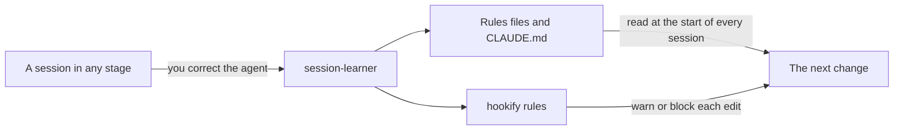

import LifeMap from '~/components/LifeMap.astro'
import StageCommands from '~/components/StageCommands.astro'

cc-toolkit is built around the agentic development lifecycle (ADLC): the stages a change goes through when Claude Code writes the code and you make the decisions.
This page explains the idea, shows where you take part, and maps each stage to the plugins and skills that carry it.
Each stage then has its own page with the steps in order.

## What changes when an agent writes the code

In a classic software development lifecycle (SDLC), writing the code is the slow part, and the process is built around it.
An agent writes code in minutes, so the cost moves to two places: deciding what to build, and checking that what was built is right.
Without a process for those two, four failures keep coming back:

- **The agent guesses.** A one-line request leaves gaps, and the agent fills each one with an assumption that surfaces only in review.
- **The context fills up.** One session for a large change gives the late tasks the least attention.
- **The code is confident and wrong.** It builds and passes CI. It still misses the spec, breaks a team rule or is unsafe, and the agent reports it as done.
- **The reviewer drowns.** A person gets a large diff with no proof that it works and no hint where to look.

The ADLC answers each failure with a stage, and each stage has a plugin.

## The ADLC map

The map shows the cycle from left to right: Plan, Build, and Review & test in three steps.
Each colored line is one core plugin, and each station is a skill.
Gray stations belong to supporting plugins, and hookify's rule hooks run on their own, with no command.
A merged pull request loops back to Plan for the next change.

<LifeMap animate={false} />

## The principles behind the stages

### Decide before the code exists

A decision changed in planning costs a sentence; the same decision changed in review costs a branch.
In [Plan](/lifecycle/plan/), `/fd3:build-spec` checks your idea against the code and interviews you until nothing is left to decide.
Then it writes a spec and validates it against the repository.

### One task, one context

An agent works best on a task that fits in its context.
In [Build](/lifecycle/build/), `/fd3:split-to-tasks` cuts the spec into tasks, and `/fd3:implement` builds each one in its own git worktree, with independent tasks in parallel.

### Rules hold while the agent writes

A rule in `CLAUDE.md` is advice the agent can forget.
A [hookify](/plugins/hookify/) rule is checked on every tool call, so an edit that breaks it gets a warning or is blocked before it lands.

### The cheapest check runs first

Review & test runs in three steps, from the cheapest to the most expensive: the agent reviews its own branch, then tests the running app, and only then asks a person.
A person's time is the scarcest resource in the cycle, so it gets a change that already passed the other two.

### Evidence instead of trust

"It works" is a claim; a re-runnable command or a recording is evidence.
[tester](/plugins/tester/) records the command behind every verdict, and [pr-proof](/plugins/pr-proof/) records a walkthrough video of the change for the reviewer.

### People at the gates, not in the loop

The agent doesn't stop to ask about what it can look up or check.
It stops at a few fixed points where only you can decide.
These are the interview, the questions before a run, the fixes to apply, the items only a person can settle, the push, and the approval.

### Hand over files, not conversations

No stage depends on another stage's conversation.
Each stage leaves something the next one can read: a spec, task files, branches, a review report, a test report, a pull request.
That's why you can start at any stage and stop at any stage.

### Every correction becomes a rule

A correction you type in chat is gone when the session ends.
[Maintain](/lifecycle/maintain/) turns corrections into rules that every later session reads, so the same mistake doesn't come back.

## Who does what at each stage and step

The agent does the work in every stage; you decide at the gates.

| Stage or step | The agent | You | Leaves |
|---|---|---|---|
| [Plan](/lifecycle/plan/) | Checks the idea against the code, asks questions with a recommended answer, writes and validates the spec | Answer each round and confirm the summary of decisions | A spec with a `ready` verdict |
| [Build](/lifecycle/build/) | Cuts the spec into tasks, builds them in parallel worktrees, runs the repository's checks and fixes failures | Answer one batch of questions, settle the items only a person can, approve the push | Branches, one per pull request |
| [Self-review](/lifecycle/self-review/) | Reviews the change through every lens that applies and merges the findings into one report | Choose which fixes to apply | A review report and the fixes |
| [Test](/lifecycle/test/) | Works out what to test, runs each check against the running app and records the evidence | Point it at a local or staging stack, or let it start one, and answer its questions | A test report in the session, with a verdict per check |
| [Human review](/lifecycle/human-review/) | Records a walkthrough, opens the pull request with a risk label, answers comments and fixes CI | Review and approve the change, and settle what the agent hands back | A pull request with green checks and settled threads, ready for approval |
| [Maintain](/lifecycle/maintain/) | Checks dependency upgrades and finds the corrections in a session | Accept or skip each proposed rule | A verdict on the upgrade, or new rules |

Table 1. What the agent does and what you decide in each stage

## The commands in each stage

<StageCommands n={2} />

## The learning loop

Maintain isn't a stage a change passes through; it feeds the cycle.
A session in any stage can end with a lesson, and that lesson becomes a rule the next run reads.

The following diagram shows how a correction becomes a rule:

Figure 2. How a correction becomes a rule for the next change

[`/session-learner:learn`](/plugins/session-learner/) proposes a rule for each correction that isn't documented yet, and writes only the ones you accept.
A rule goes to `.claude/rules/`, `CLAUDE.md`, or, when hookify is installed, a hookify rule.
[`/hookify:hookify`](/plugins/hookify/hookify/) writes a hookify rule from your description.
In Self-review, code-review reads your rules files as conventions, so it doesn't flag what they allow.
Its hookify lens replays your file-edit hookify rules over the diff and reports each match.

Dependency upgrades are the other half of Maintain.
They arrive when their maintainers release them, not after a merge, so [`/dev-kit:dep-upgrade-check`](/plugins/dev-kit/dep-upgrade-check/) runs whenever one arrives.

## Start where your change is

You don't have to start at Plan:

- **You have an idea or a ticket.** Start at [Plan](/lifecycle/plan/) with `/fd3:build-spec`.
- **You have a branch.** Start at [Self-review](/lifecycle/self-review/) with `/code-review:start-cr`.
- **Your pull request is open and stuck on CI or comments.** Go to [Human review](/lifecycle/human-review/) and run `/dev-kit:pr-shepherd`.
- **A dependency upgrade arrived.** Go to [Maintain](/lifecycle/maintain/) and run `/dev-kit:dep-upgrade-check`.

## Next steps

- Read [Plan](/lifecycle/plan/), the first stage of the cycle.
- [Install the marketplace](/getting-started/installation/) and the plugins for the stages you need.
