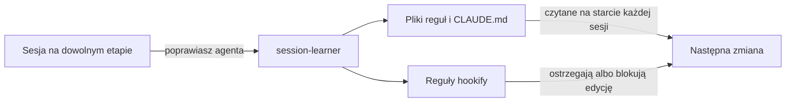

import LifeMap from '~/components/LifeMap.astro'
import StageCommands from '~/components/StageCommands.astro'

cc-toolkit jest zbudowany wokół agentowego cyklu wytwarzania oprogramowania (ADLC, od ang. agentic development lifecycle): etapów, przez które przechodzi zmiana, gdy kod pisze Claude Code, a decyzje podejmujesz ty.
Ta strona wyjaśnia ideę, pokazuje, gdzie bierzesz udział, i przypisuje do każdego etapu pluginy i skille, które go obsługują.
Każdy etap ma potem własną stronę z krokami po kolei.

## Co się zmienia, gdy kod pisze agent

W klasycznym cyklu wytwarzania oprogramowania (SDLC) pisanie kodu jest najwolniejszą częścią i cały proces jest ułożony wokół niego.
Agent pisze kod w kilka minut, więc koszt przesuwa się w dwa miejsca: decyzję, co zbudować, i sprawdzenie, czy zbudowane jest dobre.
Bez procesu dla tych dwóch rzeczy wracają cztery porażki:

- **Agent zgaduje.** Prośba w jednej linijce zostawia luki, a agent wypełnia każdą założeniem, które wychodzi na jaw dopiero w review.
- **Kontekst się zapełnia.** Jedna sesja na dużą zmianę daje ostatnim zadaniom najmniej uwagi.
- **Kod jest pewny siebie i błędny.** Buduje się i przechodzi CI, ale mija się ze specem, łamie regułę zespołu albo jest niebezpieczny, a agent zgłasza go jako gotowy.
- **Reviewer tonie.** Człowiek dostaje duży diff bez dowodu, że działa, i bez wskazówki, gdzie patrzeć.

ADLC odpowiada na każdą porażkę etapem, a każdy etap ma swój plugin.

## Mapa ADLC

Mapa pokazuje cykl od lewej do prawej: Planowanie, Budowa oraz Review i testy w trzech krokach.
Każda kolorowa linia to jeden główny plugin, a każda stacja to skill.
Zmergowany pull request wraca do Planowania po następną zmianę.

<LifeMap animate={false} />

## Zasady stojące za etapami

### Decyzja, zanim powstanie kod

Decyzja zmieniona przy planowaniu kosztuje zdanie; ta sama decyzja zmieniona w review kosztuje branch.
W [Planowaniu](/pl/lifecycle/plan/) `/fd3:build-spec` sprawdza twój pomysł z kodem, wypytuje cię, aż nie zostanie nic do zdecydowania, i pisze spec, który waliduje z repozytorium.

### Jedno zadanie, jeden kontekst

Agent pracuje najlepiej nad zadaniem, które mieści się w jego kontekście.
W [Budowie](/pl/lifecycle/build/) `/fd3:split-to-tasks` tnie spec na zadania, a `/fd3:implement` buduje każde w osobnym git worktree, niezależne zadania równolegle.

### Reguły obowiązują w trakcie pisania

Reguła w `CLAUDE.md` to rada, o której agent może zapomnieć.
Reguła [hookify](/pl/plugins/hookify/) jest sprawdzana przy każdym wywołaniu narzędzia, więc edycja, która ją łamie, dostaje ostrzeżenie albo zostaje zablokowana, zanim trafi do pliku.

### Najtańsze sprawdzenie najpierw

Review i testy idą w trzech krokach, od najtańszego do najdroższego: agent przegląda własny branch, potem testuje działającą aplikację, a dopiero na końcu prosi człowieka.
Czas człowieka to najrzadszy zasób w cyklu, więc dostaje zmianę, która przeszła już dwa poprzednie kroki.

### Dowód zamiast zaufania

„Działa” to twierdzenie; komenda do ponownego uruchomienia albo nagranie to dowód.
[tester](/pl/plugins/tester/) zapisuje komendę za każdym werdyktem, a [pr-proof](/pl/plugins/pr-proof/) nagrywa dla reviewera wideo z przejściem przez zmianę.

### Ludzie na bramkach, nie w pętli

Agent nie zatrzymuje się, żeby pytać o to, co może sam sprawdzić.
Zatrzymuje się w kilku stałych punktach, gdzie decydować możesz tylko ty: wywiad, pytania przed przebiegiem, sprawy, które rozstrzyga tylko człowiek, push i akceptacja.

### Przekazanie przez pliki, nie przez rozmowę

Żaden plugin nie czyta rozmowy innego pluginu.
Każdy etap zostawia plik albo branch, a następny zaczyna od niego: spec, pliki zadań, branche, raport z review, raport z testów, pull request.
Dlatego możesz zacząć na dowolnym etapie i na dowolnym skończyć.

### Każda poprawka staje się regułą

Poprawka wpisana w czacie znika, gdy sesja się kończy.
[Utrzymanie](/pl/lifecycle/maintain/) zamienia poprawki w reguły, które czyta każda kolejna sesja, więc ten sam błąd nie wraca.

## Kto co robi na każdym etapie

Agent wykonuje pracę na każdym etapie; ty decydujesz na bramkach.

| Etap | Agent | Ty | Zostawia |
|---|---|---|---|
| [Planowanie](/pl/lifecycle/plan/) | Sprawdza pomysł z kodem, zadaje pytania z rekomendowaną odpowiedzią, pisze i waliduje spec | Odpowiadasz w każdej rundzie i potwierdzasz podsumowanie decyzji | Spec z werdyktem `ready` |
| [Budowa](/pl/lifecycle/build/) | Tnie spec na zadania, buduje je równolegle w worktree, uruchamia walidację repozytorium i naprawia błędy | Odpowiadasz na jedną paczkę pytań, rozstrzygasz sprawy dla człowieka, zgadzasz się na push | Branche, po jednym na pull request |
| [Self-review](/pl/lifecycle/self-review/) | Przegląda zmianę każdą pasującą soczewką i scala znaleziska w jeden raport | Wybierasz, które poprawki zastosować | Raport z review i poprawki |
| [Testy](/pl/lifecycle/test/) | Ustala, co przetestować, uruchamia każde sprawdzenie na działającej aplikacji i zapisuje dowody | Dajesz lokalne albo stagingowe środowisko i odpowiadasz na jedną rundę pytań | Raport z werdyktem dla każdego sprawdzenia |
| [Review człowieka](/pl/lifecycle/human-review/) | Nagrywa walkthrough, otwiera pull request z etykietą ryzyka, odpowiada na komentarze i naprawia CI | Przeglądasz zmianę i ją akceptujesz | Zaakceptowany pull request z zielonymi checkami |
| [Utrzymanie](/pl/lifecycle/maintain/) | Sprawdza aktualizacje zależności i znajduje poprawki z sesji | Akceptujesz albo pomijasz każdą proponowaną regułę | Werdykt o aktualizacji albo nowe reguły |

Tabela 1. Co robi agent, a o czym decydujesz ty na każdym etapie

## Komendy na każdym etapie

<StageCommands n={2} />

## Pętla uczenia

Utrzymanie nie jest etapem, przez który przechodzi zmiana; ono zasila cykl.
Sesja na dowolnym etapie może skończyć się lekcją, a ta lekcja staje się regułą, którą czyta następny przebieg.

Poniższy diagram pokazuje, jak poprawka staje się regułą:

Rysunek 2. Jak poprawka staje się regułą dla następnej zmiany

[`/session-learner:learn`](/pl/plugins/session-learner/) proponuje dla każdej poprawki zmianę w `.claude/rules/`, w `CLAUDE.md` albo regułę hookify, i zapisuje tylko te, które zaakceptujesz.
[`/hookify:hookify`](/pl/plugins/hookify/hookify/) pisze regułę hookify prosto z twojego opisu.
code-review czyta te same pliki reguł jako konwencje, więc Self-review też trzyma zmianę w ich ramach.

Drugą połową Utrzymania są aktualizacje zależności.
Przychodzą, gdy wydadzą je ich opiekunowie, a nie po merge'u, więc [`/dev-kit:dep-upgrade-check`](/pl/plugins/dev-kit/dep-upgrade-check/) uruchamiasz wtedy, gdy któraś przyjdzie.

## Zacznij tam, gdzie jest twoja zmiana

Nie musisz zaczynać od Planowania:

- **Masz pomysł albo ticket.** Zacznij od [Planowania](/pl/lifecycle/plan/) i `/fd3:build-spec`.
- **Masz branch.** Zacznij od [Self-review](/pl/lifecycle/self-review/) i `/code-review:start-cr`.
- **Pull request jest otwarty i utknął na CI albo komentarzach.** Idź do [Review człowieka](/pl/lifecycle/human-review/) i uruchom `/dev-kit:pr-shepherd`.
- **Przyszła aktualizacja zależności.** Idź do [Utrzymania](/pl/lifecycle/maintain/) i uruchom `/dev-kit:dep-upgrade-check`.

## Następne kroki

- Przeczytaj o [Planowaniu](/pl/lifecycle/plan/), pierwszym etapie cyklu.
- [Zainstaluj marketplace](/pl/getting-started/installation/) i pluginy do etapów, których potrzebujesz.
