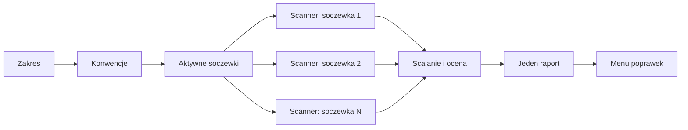

Ta strona prowadzi jedno review od zmienionych plików do menu poprawek.
Jest dla tych, którzy chcą wiedzieć, dlaczego soczewka ruszyła albo nie, skąd uwaga ma swoją wagę i dlaczego poprawka trafiła do tej, a nie innej opcji menu.
Jak uruchomić review, opisuje [przewodnik po start-cr](/pl/plugins/code-review/start-cr/).

## Przebieg

Review raz ustala wszystko, co jest wspólne dla soczewek, potem rozdziela pracę, a na końcu zbiera wyniki w jednym miejscu:

Rysunek 1. Jedno review, od zmienionych plików do menu poprawek

1. **Zakres.** Lista plików powstaje raz, a każdy scanner dostaje wycinek tej samej listy.
2. **Konwencje.** Reguły projektu są czytane raz, do jednej notatki, którą dostaje każdy scanner.
3. **Aktywne soczewki.** O tym, które soczewki ruszają, decyduje wejście. Ty ich nie wybierasz.
4. **Skan.** Na każdą aktywną soczewkę przypada jeden agent scanner. Wszystkie oceniają zmianę równolegle i zapisują uwagi do pliku.
5. **Scalanie i ocena.** Orkiestrator zbiera pliki soczewek, usuwa duplikaty, ponownie ocenia wagę według jednej tabeli i składa jeden raport.
6. **Menu poprawek.** Jedno pytanie pokazuje poprawki pocięte według ryzyka i pyta, jak je zacommitować.

## Soczewki

Soczewka to jeden zestaw spisanych reguł.
Jest ich jedenaście: dziewięć rusza przy każdej zmianie kodu, dwie zależą od wejścia.

| Soczewka | Kiedy rusza | Czego szuka |
|---|---|---|
| comments | zawsze | Komentarzy, które opowiadają kod, cytują zgłoszenia albo inne pliki, przeczą kodowi, albo ich brakuje tam, gdzie decyzja wymaga wyjaśnienia. |
| readability & tests | zawsze | Zagnieżdżeń, które spłaszczyłby guard clause, nienazwanych magicznych wartości, funkcji robiących kilka rzeczy, testów, które nie sprawdzają tego, co obiecuje ich nazwa. |
| naming & module | zawsze | Nazw ukrywających intencję, zapytań zmieniających stan, importów w złą stronę, helperów dublujących te, które repozytorium już ma. |
| objects & patterns | zawsze, oprócz zmian samego kodu infrastruktury | Niedokończonych obiektów, wystawionych wewnętrznych kolekcji, metod na złym obiekcie, powtarzanych switchy po typie. |
| simplicity & types | zawsze | Duplikacji, która składa się w jeden kształt, kodu dłuższego niż jego idea, zbędnych rzutowań, martwego kodu. |
| correctness | zawsze | Warunków wybierających złą gałąź, nieobsłużonych przypadków, błędów o jeden, połkniętych błędów, wyścigów, złamanych kontraktów wywołań. |
| security | zawsze | Sekretów w źródłach, injection, brakujących kontroli dostępu, niewalidowanego wejścia, niebezpiecznych ustawień, poszerzonego dostępu, w kodzie, politykach i workflowach CI. |
| coherence | zawsze | Dwóch artefaktów opisujących to samo inaczej: dokumentacji, kontraktów, migracji albo konfiguracji niezgodnych z kodem, albo kodu łamiącego regułę z przyjętego ADR-a lub `CONTEXT.md`. |
| assumptions | zawsze | Kodu, który polega na zachowaniu biblioteki, runtime'u, CI albo platformy sprzecznym z zainstalowanym źródłem lub zablokowaną wersją, i dublerów testowych, do których prawdziwa zależność by nie pasowała. |
| performance | w zmianie jest kod wykonywalny | Wywołań N+1, nieograniczonych pobrań, blokujących wywołań na ścieżkach async, zbędnych renderów Reacta, zapytań po nieindeksowanych kolumnach. |
| spec | wskazano spec | Linii specu, których nic nie implementuje, implementacji błędnych albo częściowych i zachowań, o które spec nie prosił. |

Tabela 1. Jedenaście soczewek i kiedy każda rusza

### Jak wejście je włącza

- **performance** rusza, gdy w zmianie jest kod wykonywalny. Testy, helpery testowe, kod infrastruktury, pliki `.sh` i moduły `*.config.*` się nie liczą.
- **spec** rusza, gdy `--spec` wskazuje czytelny lokalny plik albo gdy przyjmiesz spec znaleziony przez review w zmianie.
- **objects & patterns** jest wyłączona, gdy każdy plik, który by czytała, to kod infrastruktury, bo jej reguły nie mają tam odpowiednika.
- **Soczewka bez własnych plików jest wyłączona.** Zmiana samych polityk dostępu uruchamia tylko security, assumptions i coherence. Zmiana samych dokumentów, changesetów albo danych konfiguracyjnych uruchamia tylko coherence, która czyta z repozytorium kod opisywany przez każde twierdzenie.

Gdy spec jest aktywny, każda z tych soczewek rusza razem ze spec.
Tally w raporcie liczy soczewki, które ruszyły (`Lenses: L of 11`), i wymienia każdą, która nie ruszyła, z powodem.

### Co czyta każda soczewka

Każdy oceniany plik dostaje rodzaj: `source`, `test`, `iac` albo `policy`.
Testy dostają wszystkie soczewki oprócz performance.
Polityki dostępu (`*.rego`, `*.cedar`, manifesty Cerbos i RBAC Kubernetesa, pliki polityk IAM), `CODEOWNERS` i pliki workflowów CI trafiają tylko do security, assumptions, coherence i spec.

JSON, lockfile'e, pliki wygenerowane albo zminifikowane, Markdown, `.txt` i statyczna konfiguracja, np. `.yaml`, `.toml`, `.ini` i `.env`, są pomijane i wymienione w linii `Skipped` raportu.
Dwie soczewki i tak je czytają:

- **coherence** czyta każdy pominięty plik oprócz lockfile'i, wygenerowanego kodu i prawdziwych plików `.env`, bo README, migracja albo plik compose to jedna ze stron niezgodności, których szuka.
- **spec** zestawia spec z każdym zmienionym plikiem, także pominiętym, bo linia specu często opisuje właśnie workflow albo manifest.

Prawdziwy plik `.env` nigdy nie jest czytany.
Obie soczewki szukają w nim tylko nazw kluczy, nigdy wartości.

## Jeden scanner na soczewkę

Każda aktywna soczewka działa jako osobny agent `code-review:scanner`.
Scanner wywołuje skill `cr-scan`, czyta plik reguł swojej soczewki, ocenia zmianę i zapisuje wynik do `<lens>.md` w katalogu kontekstu review.

- **Widzi tylko to, co przygotowało review.** Scanner nie ładuje `CLAUDE.md`. Konwencje projektu dostaje jako `conventions.md`, tę samą notatkę co każda soczewka.
- **Ma tylko narzędzia potrzebne soczewce:** Skill, Read, Grep, Glob, Bash i Write. Niczego nie edytuje w checkoucie i nie uruchamia agentów.
- **Działa na modelu twojej sesji.** `start-cr` nie podaje scannerom modelu.
- **Przekazuje wątpliwości dalej, zamiast je porzucać.** Trzy kanały boczne niosą to, czego scanner nie rozstrzygnie sam: `HANDOFF` dla problemu innej soczewki, wpis `CANDIDATES`, gdy dopasowanie reguły jest niepewne, i znacznik `(verify)`, gdy trzeba sprawdzić sam fakt.

Osobne scannery to sedno.
Każdy czyta zmianę niezależnie, więc gdy kilka trafia w ten sam kod, ta zgodność coś znaczy.

## Konwencje wyciszają, standardy tworzą uwagi

Zanim ruszy jakakolwiek soczewka, review czyta reguły twojego projektu.
Są dwa rodzaje plików:

- **Pliki, które tylko usuwają uwagi:** `CLAUDE.md` i `AGENTS.md` (w katalogu głównym i w każdym katalogu aż do ocenianego pliku), `CONTRIBUTING.md`, `.cursor/rules` i `.claude/rules/*.md`. Gdy któryś opisuje styl, review przestaje go zgłaszać.
- **Pliki, które tworzą uwagi:** `CODING_STANDARDS.md` w katalogu głównym repozytorium i ignorowany przez gita `CODING_STANDARDS.local.md` obok niego. Jawna reguła z tych plików staje się uwagą `standards`, która ją cytuje.

Zapisy decyzji też tworzą uwagi.
Soczewka coherence zgłasza kod łamiący regułę z przyjętego ADR-a, `CONTEXT.md` albo dokumentu decyzji w zmianie.
Pełne zasady są w [dokumentacji referencyjnej](/pl/plugins/code-review/reference/#pliki-projektu-czytane-przez-review).

## Centralna ponowna ocena

Scannery oceniają kod; orkiestrator decyduje, co zostaje.
Scala pliki soczewek przez te kontrole:

1. **Czy każda soczewka dostarczyła wynik.** Brak pliku soczewki, plik bez nagłówka `Lens:` albo plik, który przedstawia się jako lista częściowa, oznacza soczewkę, która się nie zgłosiła. Review uruchamia ją ponownie i nigdy nie scala z pominięciem luki.
2. **Duplikaty.** Gdy dwie uwagi wskazują ten sam kod, z dowolnych soczewek, każda jest najpierw ponownie oceniona, a zostaje ta, której reguła daje najwyższą wagę.
3. **Zbieżność.** Uwaga, do której kilka soczewek doszło niezależnie, prowadzi swój plik. Zbieżność podnosi pewność i kolejność, nigdy wagę.
4. **Każdy handoff i kandydat dostaje miejsce.** Staje się ocenioną uwagą, łączy się z inną albo trafia do `Not flagged` z powodem.
5. **Każdy znacznik `(verify)` zostaje rozstrzygnięty** przez przeczytanie kodu. Obalona uwaga wypada z adnotacją.
6. **Każda waga jest oceniana ponownie** według jednej głównej tabeli 68 reguł. Ocena scannera to pierwsze podejście; trafia dalej wiersz z tabeli.
7. **Ocena poprawki, nie tylko uwagi.** Poprawka, która zmieniłaby to, co widzą wywołujący, przeczyłaby innej poprawce albo stworzyłaby kolejną uwagę, trafia do przechodzenia strukturalnego albo zostaje tylko do raportu.

Krok 4 jest publikowany jako jedna policzona linia nad raportem, na przykład `Reconciliation: 3 handoffs + 2 candidates → 2 merged · 1 own bullet · 0 boy-scout · 2 Not flagged; 0 primary dropped · 1 passed on`.
Liczby muszą się zgadzać, więc zgubiony wpis widać od razu.

## Jedno menu poprawek

Każda zachowana uwaga dostaje jedną klasę ryzyka poprawki: `safe`, `structural` albo `report-only`.
Menu pokazuje te klasy jako opcje, najwyżej cztery i tylko te, w których są uwagi:

- **Bezpieczne poprawki** są mechaniczne i łatwe do sprawdzenia wzrokiem. Poprawka, która zmienia sygnaturę, edytuje drugi plik, tworzy moduł albo dodaje import, nigdy nie jest bezpieczna.
- **Poprawki strukturalne** przenoszą albo usuwają kod. Przechodzisz je po jednej i każda wymaga osobnego „tak”.
- **Poprawki security nigdy nie są bezpieczne.** Nawet najmniejsze zmieniają zachowanie na granicy.
- **Uwagi ze specu są tylko do raportu.** Brakujące wymaganie to praca do wykonania, nie edycja. Wyjątkiem jest zweryfikowana błędna implementacja, którą naprawia jedna edycja.
- **Część poprawek coherence i assumptions jest tylko do raportu**: tam, gdzie racja może leżeć po stronie, którą poprawka by przepisała, albo gdy poprawka leży poza repozytorium, np. podbicie zależności.

Przed pierwszą edycją raport i twój wybór trafiają do pliku w katalogu roboczym sesji, więc długie przechodzenie poprawek przetrwa kompakcję kontekstu.

## Co zostaje na dysku

| Ścieżka | Co zawiera |
|---|---|
| katalog kontekstu, w katalogu roboczym sesji | `scope.json` (pliki, rodzaje, baza, zestaw soczewek), `conventions.md`, `standards.md` i jeden `<lens>.md` na scanner. |
| plik raportu, w katalogu roboczym sesji | Złożony raport, twój wybór i znacznik przy każdej poprawce, gdy wchodzi. |
| `<repo>.worktrees/cr-pr-<number>` | Przy `--pr`, gdy checkout nie stoi na headzie pull requesta. Usuń go przez `git worktree remove`. |
| plik szkicu review | W trybie reviewera treść żądania do review na GitHubie, zostawiona, gdy wybierzesz brak publikacji. |

Tabela 2. Co zostawia po sobie review

Nic więcej nie jest zapisywane i nic nie jest commitowane, jeśli nie wybierzesz trybu commitów.

## Następne kroki

- [Uruchom review przez `/code-review:start-cr`](/pl/plugins/code-review/start-cr/).
- Argumenty i kroki bez interakcji znajdziesz w [dokumentacji referencyjnej](/pl/plugins/code-review/reference/).
