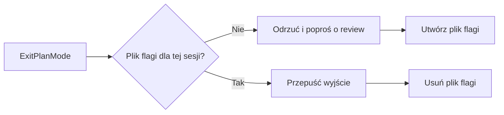

import LifeMap from '~/components/LifeMap.astro'
import SkillFlow from '~/components/SkillFlow.astro'
import Strip from '~/components/Strip.astro'

Plan napisany przez jeden model ma martwe pola tego modelu.
codex-plan-improver daje drugą opinię od OpenAI Codex, zanim powstanie choć linijka kodu.
Claude wysyła plan do Codexa, poprawia go na podstawie uwag i powtarza to, aż Codex go zaakceptuje albo minie pięć rund.

Plugin ma dwie części:

- **Hook**, który prosi Claude’a o review za każdym razem, gdy ten wychodzi z trybu planowania.
- **Komendę** `/codex-plan-improver:codex-review`, która przeprowadza review. Hook prosi Claude’a o jej uruchomienie, a ty możesz uruchomić ją ręcznie.

## Gdzie działa

<LifeMap focus="codex-plan-improver" animate={false} />

Review odbywa się w etapie [Planowanie](/pl/lifecycle/plan/), na planie, który Claude napisał w trybie planowania albo na czacie.

## Zanim zaczniesz

Potrzebujesz [OpenAI Codex CLI](https://github.com/openai/codex), zainstalowanego i zalogowanego:

```bash
npm install -g @openai/codex
codex login
```

Zamiast `codex login` możesz ustawić klucz API w zmiennej środowiskowej.
Plugin potrzebuje też `jq` i `uuidgen` w `PATH` oraz zapisywalnego `/tmp`.
macOS ma `uuidgen` w standardzie; `jq` zainstalujesz przez `brew install jq`.

Jeśli podsumowanie instalacji mówi, że trzeba przeładować pluginy, uruchom `/reload-plugins`, żeby hook zaczął działać.

## Review przy wyjściu z trybu planowania

Pracuj w trybie planowania jak zwykle. Nic nie musisz uruchamiać:

1. Claude wywołuje `ExitPlanMode`, żeby pokazać ci plan.
2. Hook odrzuca to wywołanie i każe Claude’owi uruchomić `/codex-plan-improver:codex-review`.
3. Claude przeprowadza review i poprawia plan.
4. Claude ponownie wywołuje `ExitPlanMode`. Hook je przepuszcza i widzisz poprawiony plan.

Poniższy diagram pokazuje, jak hook w obrębie sesji decyduje, czy przepuścić wyjście:



Rysunek 2. Hook działa naprzemiennie: odrzuca jedno wyjście, przepuszcza następne, potem znowu odrzuca.

Dzięki temu plan, który odrzucisz, a Claude poprawi, przechodzi review ponownie przy następnym wyjściu.

:::caution
Hook prosi o review, ale nie może go wymusić. Jeśli Claude pominie review i drugi raz wywoła `ExitPlanMode`, to wyjście przejdzie bez review.
:::

## Ręczne review planu

Uruchom komendę w dowolnym momencie, gdy w rozmowie jest plan:

<Strip cmd="/codex-plan-improver:codex-review" />

Jeśli w rozmowie nie ma planu, Claude zapyta, co chcesz poddać review.

Domyślny model to `gpt-6.1-sol`.
Żeby użyć innego, podaj jego nazwę jako argument, na przykład `/codex-plan-improver:codex-review gpt-6-astra`.
Zadziała każda nazwa modelu, którą twój Codex CLI przyjmuje w `codex exec -m`.
Ustawienie `model` w `~/.codex/config.toml` nie ma znaczenia, bo komenda zawsze przekazuje `-m`.

## Jak przebiega

<SkillFlow
  n={3}
  skill="codex-review"
  input="Plan w rozmowie"
  steps={[
    { name: 'Zapis', does: 'Claude zapisuje plan do pliku tymczasowego.', leaves: '/tmp/claude-plan-<id>.md' },
    { name: 'Review', does: 'Codex ocenia plan w sandboksie tylko do odczytu i kończy werdyktem.', leaves: '/tmp/codex-review-<id>.md' },
    { name: 'Poprawki', does: 'Przy REVISE Claude zmienia plan i wypisuje każdą zmianę.', loop: 'z powrotem do tej samej sesji Codexa, maksymalnie pięć rund' },
    { name: 'Koniec', does: 'Claude pokazuje końcowy status i usuwa oba pliki tymczasowe.' },
  ]}
/>

Codex sprawdza w planie poprawność, ryzyka, brakujące kroki, prostsze alternatywy i bezpieczeństwo.
Może czytać twoje repozytorium dla kontekstu, ale nie może zmieniać plików.
Kolejne rundy wznawiają tę samą sesję Codexa, więc Codex pamięta wcześniejsze rundy.

## Co zobaczysz

W każdej rundzie Claude pokazuje dwa bloki:

- **Codex Review — Round N:** uwagi Codexa, zakończone `VERDICT: APPROVED` albo `VERDICT: REVISE`.
- **Revisions (Round N):** co Claude zmienił w planie, po jednym punkcie na uwagę.

Review kończy się statusem: zaakceptowano po N rundach albo „Max rounds (5) reached” z listą pozostałych zastrzeżeń.
Jeśli Codex nie poda jasnego werdyktu, ale nie zgłosi nic do poprawy, Claude uznaje plan za zaakceptowany.
Claude pomija każdą sugestię Codexa sprzeczną z wymaganiem, które podajesz, i informuje cię o tym.

## Wyłączenie automatycznego review

Ustaw `CC_TOOLKIT_CODEX_PLAN_REVIEW` na dowolną wartość inną niż `1` albo `true`:

```bash
export CC_TOOLKIT_CODEX_PLAN_REVIEW=0
```

Hook przepuszcza wtedy każde `ExitPlanMode`. Ręczna komenda działa dalej.
[Dokumentacja referencyjna](/pl/plugins/codex-plan-improver/reference/) zawiera wszystkie ustawienia i pliki, które plugin zapisuje.

## Co może pójść nie tak

- **Hook nigdy nie prosi o review.** Sprawdź, czy `jq` jest w `PATH`. Bez niego hook nie może odpowiedzieć i każde wyjście przechodzi bez review.
- **Brak Codex CLI albo błąd Codexa.** Claude informuje cię o tym i proponuje instalację przez `npm install -g @openai/codex`.
- **Nie da się wznowić sesji Codexa**, na przykład bo wygasła. Claude wraca do nowego wywołania Codexa i dołącza do promptu wcześniejsze rundy.
- **Pięć rund mija bez akceptacji.** Claude wypisuje pozostałe zastrzeżenia, a ty decydujesz, czy iść dalej, czy dopracować plan.

## Następne kroki

- Zbuduj zaakceptowany plan: zobacz [Budowa](/pl/lifecycle/build/).
- Przy zmianie, w której każda decyzja musi zapaść i zostać sprawdzona z kodem, napisz spec przez [`/fd3:build-spec`](/pl/plugins/fd3/build-spec/).
