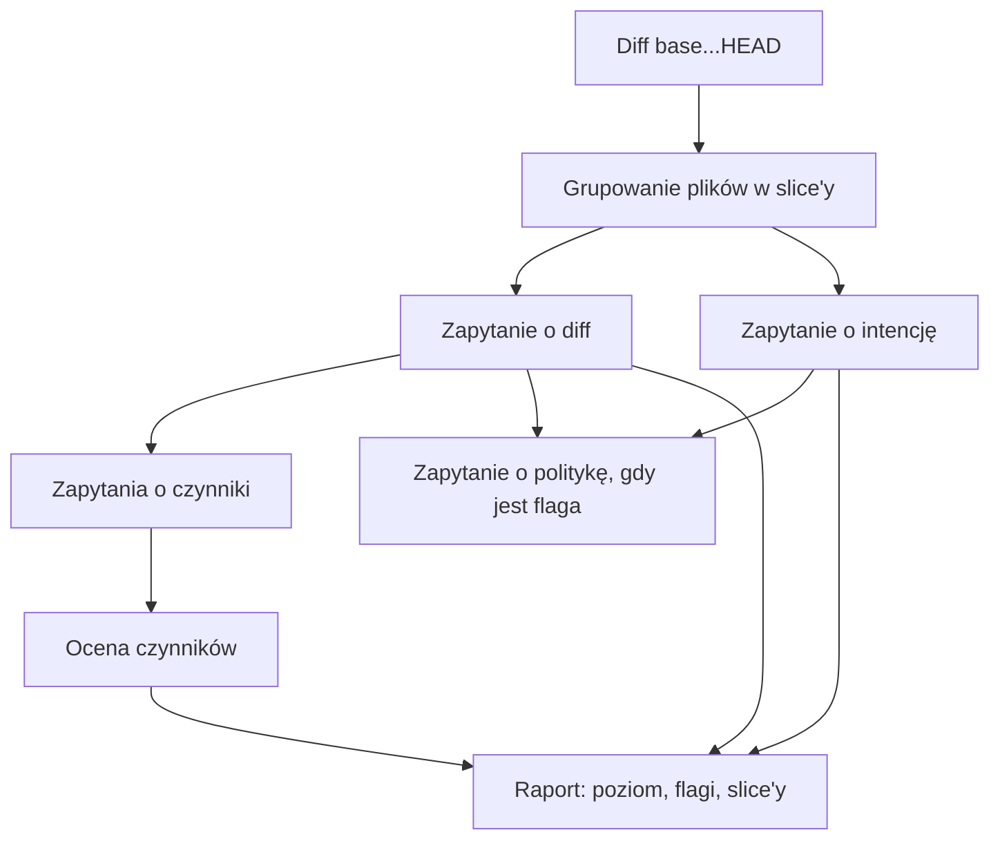

Ta strona śledzi jedną ocenę od diffu do poziomu na etykiecie. Jest dla tych, którzy chcą wiedzieć, skąd pull request ma swój poziom, albo chcą zmienić sposób oceny. Jak wynik wygląda na pull requeście, opisuje strona [Etykieta ryzyka](/pl/plugins/dev-kit/risk-assessment/).

W skrócie: zmiana jest dzielona na slice’y, model Jev od TypeSafe odpowiada na stałe pytania o każdy slice, a kod zamienia odpowiedzi w poziom. Jev nigdy sam nie wybiera poziomu. Każda reguła, która zamienia odpowiedzi w poziom, jest w kodzie i trafia do wyniku.

## Przebieg

Poniższy diagram pokazuje kroki jednej oceny i zapytania wysyłane dla każdego slice’a:

Rysunek 1. Zapytania jednej oceny, od diffu do raportu

1. Narzędzie czyta diff brancha względem bazy.
2. Grupuje zmienione pliki w slice’y.
3. Dla każdego slice’a wysyła równolegle zapytanie o diff i zapytanie o intencję, a potem zapytania o czynniki.
4. Gdy przekazano zasady testowania repozytorium, slice oznaczony jako logika bez testów dostaje jeszcze jedno zapytanie, zapytanie o politykę.
5. Kod ocenia odpowiedzi o czynniki, wylicza poziom i buduje raport.

Naraz działają najwyżej cztery zapytania do Jev. Zapytanie, które padnie przez rate limit albo błąd serwera, jest próbowane łącznie do trzech razy.

## Krok 1: odczyt diffu

Narzędzie liczy diff `<base>...HEAD`, wybierając `origin/<base>` przed lokalnym branchem. Pomija lockfile'y, pliki binarne, pliki zminifikowane, source mapy, snapshoty i wszystko w `dist/`, `build/`, `vendor/` albo `node_modules/`. Przycina linie kontekstu do jednej wokół każdej zmiany, dzięki czemu w jednym zapytaniu mieści się więcej zmiany.

Zmiana złożona wyłącznie z pominiętych plików nie dostaje poziomu `low`. Narzędzie zgłasza ją jako niedostępną.

## Krok 2: grupowanie plików w slice’y

Slice to jeden cel zmiany, na przykład funkcja, poprawka albo refaktor, razem z każdym plikiem, który mu służy: kodem, testami, konfiguracją i dokumentacją. Dzięki slice’om pull request z ryzykowną poprawką i nieszkodliwą zmianą dokumentacji pokazuje oba poziomy zamiast jednego uśrednionego.

Slice’y pochodzą z pierwszego źródła, które zadziała:

1. **Wywołujący.** `pr-open` przekazuje slice’y, które widzi w diffie.
2. **Claude Haiku.** Bez slice’ów od wywołującego Haiku grupuje pliki na podstawie ścieżek, liczby linii, nagłówków hunków i opisów commitów.
3. **Rozmiar.** Gdy Haiku zawiedzie, diff jest pakowany według rozmiaru i oceniany jako jedna zmiana bez podziału.

Każdy plik trafia do dokładnie jednego slice’a. Slice’ów jest najwyżej osiem, a pliki, które grupowanie pominęło, trafiają do slice’a **Other changes**.

## Krok 3: pytania do Jev o każdy slice

Jev odpowiada na pytania w dwóch formach. Pytanie tak/nie zwraca prawdopodobieństwo odpowiedzi „tak”. Pytanie ze skalą zwraca prawdopodobieństwo dla każdego poziomu skali. Narzędzie odczytuje „tak”, gdy prawdopodobieństwo wynosi co najmniej 0,7. Kilka typów zmian, które Jev zgłasza za często albo za rzadko, używa progu 0,8 albo 0,6. Poziom w pytaniu ze skalą to mediana jego prawdopodobieństw.

### Zapytanie o diff

Zapytanie o diff zawiera listę plików slice’a i jego diff. Dokumentacja, źródła diagramów i changesety trafiają do osobnego pola, żeby Jev nie pomylił opisu zmiany z kodem, który ją wprowadza. Pliki instrukcji dla agentów, takie jak `CLAUDE.md`, zostają przy kodzie, bo sterują agentem.

Pyta o:

- **Typy zmian:** pytania tak/nie o to, czego dotyka slice, na przykład migracji schematu, autoryzacji, kontraktu API, CI, infrastruktury chmurowej, komponentów UI albo aktualizacji zależności. [Referencja](/pl/plugins/dev-kit/risk-assessment/reference/#typy-zmian-i-flagi) wymienia te, które podnoszą flagi.
- **Wpływ i prawdopodobieństwo:** dwa pytania ze skalą, które ustalają poziom slice’a tylko wtedy, gdy zawiodą zapytania o czynniki. Zobacz [Pewność, wyniki częściowe i awarie](/pl/plugins/dev-kit/risk-assessment/reliability/#gdy-jev-nie-odpowiada).

### Zapytanie o intencję

Zapytanie o intencję nie zawiera treści plików. Zawiera przekazany `context`, opisy commitów oraz status w gicie i liczbę linii każdego pliku. Pyta, co robi slice: dodaje nową funkcjonalność, zmienia istniejące zachowanie, zmienia warunki, w których istniejące zachowanie działa, naprawia błąd, refaktoryzuje, zmienia nazwę albo przenosi, czy usuwa kod. Zmiana nazwy albo usunięcie zgłoszone przez gita liczy się bez pytania.

### Zapytania o czynniki

Zapytania o czynniki decydują o poziomie. Zawierają diff kodu slice’a bez dokumentacji, a gdy slice ma też inny kod, także bez testów. Slice złożony z samej dokumentacji nie dostaje zapytań o czynniki i nie dodaje ryzyka.

Zapytanie o czynniki pyta o:

| Pytanie | Skala |
|---|---|
| **Wpływ błędu** | none, minor, feature, core, severe |
| **Złożoność** | edits, simple logic, interacting logic, outside dependency, ordering or shared state |
| **Zmiana zachowania** | od „użytkownicy dostają dokładnie to, co wcześniej” do „coś, na czym polegali użytkownicy, zostaje zastąpione albo zabrane” |
| **Zasięg, odwracalność, szerokość awarii i obsługa awarii** | dają kontekst odpowiedziom o wpływ i złożoność |
| **Ręczny dowód** | czy wideo, zrzuty ekranu albo zapytanie i odpowiedź API pokazałyby, że slice działa? |

Tabela 1. Pytania o czynniki

Obok wysyłane jest zapytanie o testowalność, z plikami testów z całej zmiany. Pyta, czy automatyczny test mógłby rozsądnie sprawdzić slice. Slice złożony z samych testów nie dostaje pytań o ręczny dowód ani testowalność.

Odpowiedzi Jev różnią się między dwoma identycznymi zapytaniami. Dlatego każde zapytanie o czynniki i o testowalność jest wysyłane dwa razy, a prawdopodobieństwa z obu odpowiedzi są uśredniane, zanim zostanie odczytana mediana.

### Zapytanie o politykę

Gdy `pr-open` znalazł zasady testowania repozytorium, slice oznaczony jako logika bez testów dostaje jeszcze jedno zapytanie. Zawiera ono zasady, statystyki plików slice’a, jego typy zmian i pliki testów ze zmiany. Pyta, czy zasady wymagają testów, których zmiana nie ma. Gdy Jev odpowie, że nie, flaga znika, a slice nie liczy się jako luka w testach. Nieudane zapytanie o politykę zostawia flagę.

## Krok 4: ocena odpowiedzi

Poziom wynika z dwóch wartości na slice: wpływu błędu i prawdopodobieństwa błędu.

### Wpływ i prawdopodobieństwo

Wpływ to odpowiedź o wpływ z zapytania o czynniki:

| Wpływ | Błąd by… |
|---|---|
| none | nie dotknął użytkowników, zapisanych danych ani działających systemów |
| minor | wywołał usterkę, którą ludzie szybko zauważą, na przykład zły tekst albo układ, i niczego nie stracił |
| feature | zepsuł jedną funkcję części użytkowników do czasu wdrożenia poprawki; revert przywraca wszystko |
| core | zepsuł kluczowy przepływ większości użytkowników, położył usługę albo zablokował buildy lub wdrożenia innych zespołów |
| severe | ujawnił dane albo dostęp, utracił lub uszkodził zapisane dane albo wywołał skutki, których revert nie cofnie, na przykład wysłane wiadomości lub płatności |

Tabela 2. Poziomy wpływu

Prawdopodobieństwo wynika ze złożoności. Logikę zależną od czegoś spoza diffu równie trudno napisać poprawnie, co kilka współdziałających ścieżek w nim, więc obie liczą się jako nietrywialne:

| Złożoność | Prawdopodobieństwo |
|---|---|
| edits | mechanical |
| simple logic | simple |
| interacting logic | non-trivial |
| outside dependency | non-trivial |
| ordering or shared state | intricate |

Tabela 3. Od złożoności do prawdopodobieństwa

### Macierz ryzyka

Wpływ i prawdopodobieństwo spotykają się w tej macierzy:

| Wpływ \ Prawdopodobieństwo | mechanical | simple | non-trivial | intricate |
|---|---|---|---|---|
| none | low | low | low | low |
| minor | low | low | low | medium |
| feature | low | medium | medium | high |
| core | medium | medium | high | high |
| severe | medium | high | critical | critical |

Tabela 4. Macierz ryzyka

Mechaniczna edycja czegoś o wpływie severe, na przykład zmiana nazwy w politykach dostępu, dostaje `medium`. `critical` dostaje tylko prawdopodobny błąd o poważnym skutku.

Każdy slice dostaje własny poziom z własnego wpływu i prawdopodobieństwa. Poziom całej zmiany bierze najgorszy wpływ spośród slice’ów i najgorsze prawdopodobieństwo spośród slice’ów. Dwa slice’y mogą się więc połączyć: edycja konfiguracji o wpływie severe i zawiły refaktor w innym miejscu tego samego pull requesta razem dają `critical`.

### Reguły, które przesuwają poziom

Cztery reguły zmieniają wynik macierzy. Każda, która ma zastosowanie, jest wymieniona w polu `adjustments` wyniku.

- **Strażnik critical.** Wpływ severe gdziekolwiek razem ze złożonością non-trivial albo intricate gdziekolwiek daje zmianie poziom `critical`. Ręczny dowód go nie obniża.
- **Próg dla wersji major.** Gdy manifest zależności slice’a podnosi zależność runtime'ową do nowej wersji major, jego prawdopodobieństwo wynosi co najmniej non-trivial. Zmiany łamiące są w zależności, a nie w diffie, który czyta Jev.
- **Uznanie dowodu.** Prawdopodobieństwo slice’a spada o jeden stopień, gdy spełnione są wszystkie warunki:
  - jego wpływ to feature albo mniej;
  - Jev jest pewny (0,7 lub więcej), że co najmniej jeden rodzaj ręcznego dowodu pokazałby, że slice działa;
  - opis zawiera każdy rodzaj dowodu, który Jev uznaje za prawdopodobny (powyżej 0,3);
  - slice nie ma luki w testach.

  Uznanie dowodu nigdy nie obniża slice’a poniżej progu dla wersji major.
- **Luka w testach.** Slice, który zmienia zachowanie i nie ma testu, ma lukę w testach. Nie ma jej, gdy żaden automatyczny test nie mógłby go sprawdzić albo gdy zwalniają go zasady testowania. Luka w testach blokuje uznanie dowodu: zrzut ekranu nie zastępuje brakującego testu.

Przykład: slice, który zmienia formularz ustawień, ma wpływ feature i prostą logikę, więc dostaje `medium`. Ze zrzutem ekranu w opisie i testem obok formularza spada do prawdopodobieństwa mechanical i dostaje `low`. Bez testu zostaje na `medium`.

### Co liczy się jako test i jako dowód

Slice liczy się jako przetestowany, gdy zawiera plik testu albo gdy jeden z jego plików ma tę samą nazwę co plik testu gdziekolwiek w zmianie. `export.ts` pasuje do `export.test.ts`, `export.spec.ts` albo `export.stories.tsx`. Pliki testów obejmują stories, fixture'y, mocki oraz pliki Cypressa i Playwrighta.

Opis liczy się jako zawierający dowód, gdy ma:

- **Zrzuty ekranu:** obraz wgrany na GitHuba.
- **Wideo:** wideo wgrane na GitHuba, link do pliku `.mp4`, `.mov` albo `.webm` albo link do udostępnienia w Loomie. Wideo liczy się też jako zrzuty ekranu.
- **Zapytanie i odpowiedź API:** blok kodu, który zaczyna się od `curl` albo linii statusu HTTP, albo zawiera obiekt JSON lub pole `"status"`.

## Flagi, typy zmian i intencje

Flagi, typy zmian i intencje opisują zmianę dla reviewera. Pochodzą z zapytań o diff i o intencję i nie ustalają poziomu.

- **Flagi** są odczytywane z typów zmian. Na przykład flaga bezpieczeństwa pochodzi z typów autoryzacji, uwierzytelniania i obsługi sekretów.
- **Logic without tests** oznacza slice z kodem, który dodaje, zmienia albo naprawia zachowanie i nie ma testu. Zapytanie o politykę może ją usunąć.
- **Intencje** wypełniają kolumnę **What it does** w tabeli.

## Następne kroki

- [Pewność, wyniki częściowe i awarie](/pl/plugins/dev-kit/risk-assessment/reliability/): co się dzieje, gdy części zmiany nie da się ocenić albo Jev nie odpowiada.
- [Etykieta ryzyka: referencja](/pl/plugins/dev-kit/risk-assessment/reference/): każda opcja, wejście i pole wyniku.
