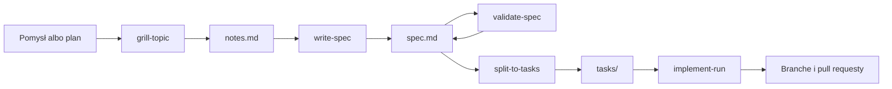

Wpisujesz trzy komendy, ale każda uruchamia kilka części.
Ta strona je nazywa, żeby można je było rozpoznać w menu `/` i w wyjściu przebiegu, i objaśnia dwa skille, które działają tylko wewnątrz `/fd3:build-spec`.

## Przepływ

Każda komenda przekazuje następnej plik, nigdy rozmowę:

Rysunek 1. Pliki przekazywane między krokami fd3

`/fd3:build-spec` uruchamia `grill-topic`, potem `write-spec`, potem `validate-spec`.
`/fd3:split-to-tasks` czyta spec i zapisuje zadania.
`/fd3:implement` uruchamia `implement-tasks`, który startuje workflow `implement-run` na zadaniach.
Każdy krok czyta pliki, więc przebieg przerwany w połowie rusza dalej z nich.

## Części

| Nazwa | Rodzaj | Kto uruchamia | Rola |
|---|---|---|---|
| `grill-topic` | skill | ty albo `build-spec` | Wywiad. |
| `write-spec` | skill, ukryty w menu `/` | `build-spec` | Pisze spec z potwierdzonych notatek. |
| `validate-spec` | skill, ukryty w menu `/` | `build-spec` | Sprawdza spec i dopisuje werdykt. |
| `split-to-tasks` | skill | ty | Tnie spec na pliki zadań. |
| `implement-tasks` | skill | `/fd3:implement` | Zadaje pytania, startuje workflow, pracuje na jego raporcie i proponuje push. |
| `implement-run` | workflow | `implement-tasks` | Fale, merge'e, checki i review. W trybie naprawczym nakłada twoje decyzje na istniejące branche. |
| `fd3:researcher` | sub-agent | skille | Szuka dokumentacji i innych zewnętrznych faktów przez context7 i firecrawl. |
| `fd3:toolchain-scout` | sub-agent | `implement-run` | Ustala komendy build, typecheck, lint i testów repozytorium, zaczynając od konfiguracji CI. |
| `fd3:ci-runner` | sub-agent | `implement-run` | Uruchamia te komendy na branchu albo na czystej bazie i czeka, aż każda się skończy. |

Tabela 1. Części, które fd3 uruchamia za ciebie

`implement-run` widać w menu `/` jako `/fd3:implement-run`.
Nie uruchamiaj go bezpośrednio: oczekuje sparsowanego grafu zadań, który przekazuje mu `implement-tasks`.

## Wewnątrz build-spec

`write-spec` i `validate-spec` działają we własnych kontekstach, więc to, co czytają, nie zapycha twojej rozmowy.
Nigdy nie uruchamiasz ich ręcznie.
Ich pytania docierają do ciebie przez `build-spec`, jako pytania wielokrotnego wyboru.

### Pisanie specu

`write-spec` czyta dwie rzeczy: notatki końcowe z wywiadu i katalog researchu.
Fakt, którego nie ma w żadnej z nich, jest deklarowany jako luka albo sprawdzany, nigdy brany z pamięci.
Spec powstaje według szablonu z dwunastoma sekcjami: nagłówek i pierwszeństwo, problem i cel, decyzje projektowe, docelowa architektura, własność, zmiana per repozytorium, rollout, weryfikacja, sprzątanie, poza zakresem, tickety i rejestr dowodów.

Każdy element, który spec każe zbudować, dostaje stały kod elementu, na przykład `DB-1` albo `API-2`.
Zadania, wiersze weryfikacji i dowody odwołują się do elementów po kodzie.
`write-spec` przenosi też pliki robocze sesji z katalogu roboczego do ignorowanego przez git katalogu `<spec>.session/` obok specu.

### Walidacja specu

`validate-spec` rozstrzyga, czy spec da się zaimplementować albo pociąć na zadania w obecnej postaci.
Uruchamia dwanaście sprawdzeń na całym dokumencie, na przykład:

- decyzje nie przeczą sobie nawzajem i nic po cichu nie odwraca wcześniejszego dokumentu,
- każdy element ma opis, kontrakt i sposób sprawdzenia dostarczonego wyniku,
- każde zewnętrzne API jest potwierdzone w swojej dokumentacji,
- kolejność budowy się trzyma, a praca naprawdę da się wdrożyć w każdym repozytorium tak, jak mówi spec,
- żadne twierdzenie nie opiera się na mglistym czasowniku ani na nierozstrzygniętym „albo–albo”.

Każde twierdzenie dostaje potem status:

| Status | Znaczenie |
|---|---|
| `verified` | Dowód się trzyma. |
| `deferred` | Spec deklaruje lukę i podaje właściciela oraz miejsce. To przechodzi. |
| `blocked` | Nic tego nie rozstrzyga, a spec nie podaje właściciela. |
| `open` | Jeszcze nierozstrzygnięte w tym przebiegu. |

Tabela 2. Statusy twierdzeń w werdykcie

Werdykt brzmi `ready`, gdy każde twierdzenie ma status verified albo deferred i żadne sprawdzenie nie zostało otwarte.
`validate-spec` edytuje spec tylko po to, żeby naprawić własne znalezisko.
Każdą komendę rozstrzygającą twierdzenie uruchamia w odłączonym worktree w katalogu roboczym, nigdy w twoim checkoucie, i nigdy nie instaluje zależności.

`build-spec` uruchamia kolejny przebieg, dopóki werdykt brzmi `not ready`, a przebieg mógłby jeszcze domknąć resztę, albo dopóki ostatni przebieg edytował spec, maksymalnie trzy przebiegi.
Gdy spec zmieni się po werdykcie końcowym, uruchamia jeszcze jeden przebieg dokładnie na tych zmianach.

## Wewnątrz implement

`implement-tasks` parsuje pliki zadań skryptem `scripts/task-graph.mjs`, który szuka cykli zależności, nieznanych statusów i błędnych baz branchy.
Uszkodzony graf zatrzymuje przebieg, z zaleceniem ponownego cięcia.

Walidacja idzie po jednym branchu, więc na twojej maszynie działa tylko jeden pipeline build, lint i testów.
Z tego samego powodu działa tylko jeden `implement-run` naraz, w dowolnym trybie: najpierw naprawy, potem ponowne uruchomienie.
Póki workflow działa, jego worktree i branche należą do niego.

Ponowne uruchomienie przekazuje ścieżkę poprzedniego raportu, więc workflow korzysta z tego, co już wie o checkach każdego repozytorium, zamiast ustalać je i mierzyć od nowa.

## Statusy zadań

Pole `status` każdego pliku zadania przechowuje stan przebiegu:

| Status | Znaczenie |
|---|---|
| `todo` | Nierozpoczęte. |
| `in-progress` | Agent nad nim pracuje. Pozostawione przez przerwany przebieg staje się pytaniem przy kolejnym uruchomieniu. |
| `implemented` | Kod jest na własnym branchu zadania, `task/<slug>`. |
| `merged` | Kod jest na branchu docelowym i czeka na checki i review. |
| `blocked` | Ruszyć je może tylko człowiek. |
| `done` | Branch przeszedł końcowe checki, a przy włączonym review także review. Nic go dla ciebie nie wstrzymuje. |

Tabela 3. Statusy zadań

Branch zostaje w `merged`, a nie `done`, gdy jego review nie ruszyło albo gdy review w trybie `gated` zostawiło dla ciebie znaleziska.

## Słowniczek

- **Spec**: dokument projektowy, który fd3 pisze i sprawdza. Każdy kolejny krok czyta spec, nie rozmowę.
- **Kod elementu**: stały kod jednej rzeczy, którą spec każe zbudować, na przykład `DB-1`.
- **Zadeklarowana luka**: coś, czego spec nie rozstrzygnął, zapisane razem z tym, kto to rozstrzyga i gdzie blokuje. Cięcie zamienia ją w zadanie dla tego właściciela.
- **Werdykt**: linia, którą walidacja dopisuje do specu.
- **Faza rolloutu, bramka**: spec układa pracę w fazy. Bramka to punkt, w którym najpierw musi się wydarzyć coś poza kodem, na przykład deploy, okres oczekiwania albo akceptacja.
- **Jednostka wdrożenia**: kolejne fazy aż do bramki włącznie. Jej zadania w jednym repozytorium dzielą branch.
- **Stackowane branche**: późniejszy branch startuje z wcześniejszego, więc jego pull request celuje w tamten branch, dopóki wcześniejszy nie zostanie zmergowany.
- **Fala**: jedna runda równoległej implementacji, obejmująca każde zadanie z ukończonymi zależnościami.
- **Element HIL** (human in the loop): wszystko, na czym przebieg się zatrzymał, bo zdecydować albo wykonać to może tylko człowiek.
- **Soczewka**: jeden punkt skupienia code review, na przykład bezpieczeństwo albo wydajność. Każda aktywna soczewka to jeden agent review.

## Następne kroki

- [Dokumentacja referencyjna](/pl/plugins/fd3/reference/) wymienia wymagania, argumenty, pliki i pola zadań.
- [Napisz pierwszy spec](/pl/plugins/fd3/#napisz-pierwszy-spec), jeśli jeszcze go nie ma.
