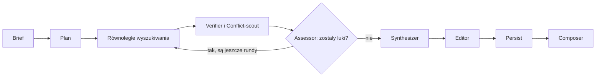

researcher składa się z dwóch części.
Skill `research` działa w twojej sesji: ustala brief, wybiera katalog raportu, uruchamia workflow i obsługuje dalsze pytania.
Dołączony workflow, `workflows/research.js`, działa w tle i wykonuje badanie, pisanie i renderowanie.
Do sesji wraca tylko ścieżka raportu i krótki manifest, więc HTML nigdy nie trafia do twojego kontekstu.

## Pętla badań

Workflow planuje kierunki wyszukiwania, a potem prowadzi rundy badań, aż asesor uzna pokrycie za wystarczające albo skończy się limit rund.
Poniższy diagram pokazuje jeden przebieg, od briefu do gotowego raportu:

Rysunek 1. Jeden przebieg workflow badawczego. Verifier działa tylko przy głębokości Deep.

Przebieg idzie przez te etapy po kolei:

1. **Setup** tworzy katalog raportu. Przy rozbudowie wczytuje `state.json` tego raportu i sprawdza wersję schematu.
2. **Plan** dzieli pytanie na odrębne kierunki, żeby równoległe wyszukiwania nie trafiały na tę samą popularną stronę. Gdy pytanie dotyczy tego, co obsługuje konkretny produkt albo standard, co najmniej jeden kierunek prowadzi do dokumentacji samego dostawcy.
3. **Rundy badań** uruchamiają równolegle retrievery, po jednym na kierunek: 3 przy Quick, 5 przy Standard i 6 przy Deep. Każdy szuka przez firecrawl, czyta najlepsze strony i wyciąga ustalenia. Gdy firecrawl zawiedzie albo strona go zablokuje, retriever przechodzi na WebSearch i odnotowuje to.
4. **Synthesizer** działa raz, po pętli. Łączy ustalenia w jedną odpowiedź ze źródłami, a sprzeczności, których nie da się rozstrzygnąć, zostawia z podaniem, kto co twierdzi.
5. **Editor** skraca odpowiedź pod wybranego odbiorcę i zaznacza, gdzie pomoże wykres, diagram, tabela albo obraz ze źródła.
6. **Persist** zapisuje ustalenia i stan, zanim cokolwiek zostanie wyrenderowane.
7. **Composer** renderuje `output.html` i kopiuje arkusz stylów. Chart.js kopiuje tylko wtedy, gdy raport ma wykres, a diagramy kompiluje przez `mmdc` tylko wtedy, gdy `mmdc` jest zainstalowany.

## Kiedy runda idzie dalej

Gdy retrievery skończą, workflow scala ich źródła po URL i nadaje każdemu nowemu źródłu kolejny wolny numer.
Potem zebrane ustalenia przechodzą do trzech kontroli, w tej kolejności:

- **Verifier** działa tylko przy Deep. Próbuje obalić ustalenia na podstawie zebranego materiału. Obalone ustalenie odpada; takie, które wymaga więcej dowodów, staje się luką.
- **Conflict-scout** działa w każdej rundzie. Szuka twierdzeń, które sobie przeczą, niczego nowego nie pobierając.
- **Assessor** jest jedyną bramką. Kończy pętlę, gdy pokrycie wystarcza i nie zostaje żadna istotna sprzeczność, którą da się rozstrzygnąć. W przeciwnym razie wypisuje konkretne luki, a każda luka staje się retrieverem w następnej rundzie, w tym samym limicie co dla danej głębokości.

Twierdzenie, że produkt coś obsługuje, poparte tylko blogami albo wątkami na forach, liczy się jako luka.
Następna runda idzie wtedy do dokumentacji samego dostawcy, zamiast zgadywać.

Pętlę ogranicza liczba rund, a nie tokenów: 1 runda przy Quick, 2 przy Standard i 3 przy Deep.
Zatrzymuje się też, gdy runda po pierwszej nie doda nowych ustaleń.
Assessor w każdym przebiegu proponuje od dwóch do czterech dalszych pytań, a skill pokazuje ci je na końcu.

## Skąd się bierze przypis

Każde źródło dostaje poziom zaufania w chwili pobrania:

| Poziom | Znaczenie |
|---|---|
| primary | Oficjalna dokumentacja, specyfikacje, standardy albo wypowiedź samego zainteresowanego |
| reputable secondary | Uznane media i znane organizacje |
| community | Fora, prywatne blogi i niezweryfikowane wpisy |

Tabela 1. Poziomy zaufania, które retriever nadaje źródłom.

Każde ustalenie niesie dowód ze swojego źródła.
Retrievery wolą dosłowny cytat.
Dla wykresu albo rysunku zapisują obraz i jego podpis.
Dla treści za paywallem albo nietekstowych zapisują lokalizator z parafrazą, oznaczony jako niedosłowny.
Synthesizer może cytować tylko numery źródeł, więc każde `[n]` w raporcie wskazuje prawdziwą pozycję na liście źródeł.

## Jak raport się rozwija

Dalsze pytanie nie dokleja nowej sekcji.
Synthesizer wczytuje z dysku wszystkie wcześniejsze ustalenia i przepisuje całą odpowiedź ze starych i nowych ustaleń razem.

Wcześniejsza praca nigdy nie zostaje nadpisana:

- Przed nowym renderem poprzedni `output.html` trafia do `snapshots/output.<UTC timestamp>.html`.
- Nowe ustalenia trafiają do nowych plików w `findings/`. Wcześniejsze pliki zostają bez zmian.
- Numery źródeł zaczynają się od najwyższego istniejącego, więc stare przypisy wskazują te same źródła.
- Diagramy i obrazy dostają nazwy z numerem rundy, więc starsze snapshoty nadal pokazują swoje.

Nowy raport w tym samym katalogu najpierw czyści `findings/`.

## Dlaczego najpierw zapis, potem render

Persist zapisuje `findings/`, `answer.md`, a na końcu `state.json`, zanim ruszy Composer.
`state.json` powstaje ostatni, więc nigdy nie wskazuje pliku z ustaleniami, którego nie zapisano.
Jeśli zapis się nie uda, przebieg kończy się błędem `persist-failed`, a poprzedni raport zostaje nietknięty.
Jeśli zawiedzie tylko render, dane są już zapisane, a kolejny przebieg wyrenderuje je ponownie.
Znaczenie każdego błędu opisuje sekcja [Kody błędów](/pl/plugins/researcher/reference/#kody-błędów).

## Następne kroki

- [Dokumentacja](/pl/plugins/researcher/reference/): ustawienia, pliki w katalogu raportu i kody błędów.
- [researcher — przegląd](/pl/plugins/researcher/): uruchom pierwszy raport.
- [`/fd3:build-spec`](/pl/plugins/fd3/build-spec/): zamień ustalenia w spec.
