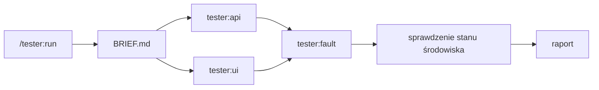

Ta strona wyjaśnia, co dzieje się w trakcie uruchomienia.
Do korzystania z testera nie jest potrzebna; zajrzyj tu, gdy werdykt cię zaskoczy albo zanim pozwolisz na prawdziwe zmiany.

## Części

`/tester:run` to jedyna część, którą uruchamiasz.
Komenda rozpoznaje środowisko, wyprowadza zestawy, zadaje pytania i pisze raport.
Każdy zestaw przekazuje jednemu z trzech agentów:

| Agent | Uruchamia | Za pomocą | Model |
|---|---|---|---|
| `tester:api` | sprawdzenia API oraz zapytania do bazy tylko do odczytu, gdy sprawdzenie ich wymaga | `curl` | `sonnet` |
| `tester:ui` | sprawdzenia w przeglądarce, ze zrzutem ekranu przy każdym nieudanym | agent-browser | `sonnet` |
| `tester:fault` | sprawdzenia obsługi błędów przez wywołanie awarii zależności | Docker, WireMock | model twojej sesji |

Tabela 1. Agenci, których `/tester:run` uruchamia, po jednym na zestaw.

`tester:api` i `tester:ui` działają na `sonnet`, żeby obniżyć koszt, bo brief rozstrzygnął już za nich każdą otwartą kwestię.
`tester:fault` używa modelu twojej sesji, bo to jedyny agent, który zakłóca współdzielone środowisko.

## Przebieg

Poniższy diagram pokazuje kolejność, w jakiej uruchamiają się zestawy:

Rysunek 1. Zestawy API i interfejsu działają równolegle; zestaw awarii uruchamia się sam i na końcu.

Zestawy API i interfejsu działają równolegle, po jednym agencie na zestaw.
Zestaw awarii czeka, aż skończą, bo wstrzymanie zależności albo postawienie przed nią proxy zepsułoby sprawdzenia, które jeszcze trwają.
Po zestawie awarii `/tester:run` samodzielnie sprawdza, czy środowisko jest zdrowe, zamiast polegać na słowie agenta.

Zestaw, który coś wyzwala i czeka minutami na efekt, na przykład eksport albo konsumenta kolejki, działa w jednym agencie, który prowadzi cały łańcuch.

## Brief

Rozpoznanie zapisuje wszystko, czego potrzebują zestawy, w jednym pliku `BRIEF.md`, i każdy agent go czyta.
Brief zawiera bazowe URL-e i ich osobliwości, użytkowników testowych i pliki ich sesji, migawkę stanu początkowego, wzorce dla curl, przeglądarki i bazy, zależności, które można zepsuć, oczekiwane zachowanie, z którym porównuje się każde sprawdzenie, oraz zasady bezpieczeństwa.

Każdy agent zwraca tylko swoją tabelę wyników i kilka notatek, bez treści żądań i logów.
Werdyktem zestawu jest ta tabela: główny wątek klasyfikuje błędy, ale nie powtarza sprawdzeń na ślepo.

## Dowód za każdym werdyktem

Sprawdzenie przechodzi tylko wtedy, gdy pokazuje to zapisana komenda.
Kilka zasad pilnuje, żeby ten dowód był rzetelny:

- **Brak werdyktu dla akcji, która nigdy się nie wykonała.** Zanim tester zgłosi, że czegoś brakuje, na przykład wiersza, linii logu albo pola, najpierw udowadnia, że akcja, która miała to wytworzyć, faktycznie się wykonała. Bez tego dowodu sprawdzenie dostaje `ERROR "stimulus not fired"`, a nie `FAIL`, bo cache i warstwy asynchroniczne potrafią po cichu połknąć wyzwalacz.
- **Dowód musi pochodzić z uruchomienia danego zestawu.** Identyfikator albo znacznik czasu sprzed startu zestawu unieważnia wiersz, a tester sprawdza go ponownie.
- **Restart otwiera nową generację.** Każdy restart aplikacji otwiera ponumerowaną generację środowiska z osobnym plikiem logu. Punkty odniesienia, sesje i liczniki z wcześniejszej generacji nie są dowodem.

## Wywoływanie awarii zależności

Zestaw awarii psuje zależność na jeden z trzech sposobów, w tej kolejności:

1. **Wstrzymuje albo zatrzymuje kontener zależności**, żeby sprawdzić przypadek „zależność nie działa”.
2. **Kieruje ustawienie bazowego URL-a zależności w aplikacji na tymczasowe proxy WireMock**, które zwraca wybrany kod 5xx, timeout albo zniekształconą odpowiedź.
3. **Dodaje w kodzie mały, odwracalny punkt wstrzyknięcia**, za twoją zgodą, gdy aplikacja nie ma ustawienia bazowego URL-a dla tej zależności.

Każde sprawdzenie awarii najpierw udowadnia, że awaria jest aktywna, a dopiero potem ocenia zachowanie aplikacji.
Zależność jest zawsze przywracana, a proxy usuwane, nawet gdy sprawdzenie zakończy się błędem.
tester pomija sprawdzenie awarii dopiero po wykluczeniu wszystkich trzech sposobów, a raport podaje, co sprawdził.

## Co zostaje na dysku

Brief, ciasteczka sesji, rejestr zmian `TEARDOWN.md` i zrzuty ekranu leżą w katalogu tymczasowym `$TMPDIR/tester.XXXXXX`, którego ścieżkę podaje raport.
Nic z niego nie trafia do commita, a ponieważ zawiera sekrety, tester nigdy nie zapisuje go w twoim repozytorium.

Twoje repozytorium zmienia się tylko wtedy, gdy zatwierdzisz punkt wstrzyknięcia albo celowo zostawisz jakąś zmianę.
Rejestr wymienia jedno i drugie.

## Zasady bezpieczeństwa

- Odrzuca bazowe URL-e, które wyglądają na produkcję.
- Robi prawdziwe zmiany przez aplikację tylko w zakresie, na który się zgodzisz.
- Zapisuje każdą zmianę w środowisku w rejestrze w chwili, gdy ją robi, cofa ją i porównuje wynik z migawką stanu początkowego.
- Usuwa dane, które utworzył w twoich magazynach, na przykład w buckecie albo skrzynce pocztowej, po dokładnej nazwie zapisanej przez aplikację, nigdy według wzorca. Liczba usuniętych elementów, która się nie zgadza, zatrzymuje sprzątanie.
- Nie wypisuje w rozmowie ciasteczek, tokenów ani haseł.

:::note
tester nie trzyma zestawu testów między uruchomieniami.
Każde uruchomienie wyprowadza sprawdzenia od nowa ze specu albo diffu, więc po zmianie kodu nie ma czego aktualizować.
:::

## Następne kroki

- [Uruchom sprawdzenie](/pl/plugins/tester/run/) przez `/tester:run`.
- Werdykty, klasy błędów i wymagania znajdziesz w [dokumentacji referencyjnej](/pl/plugins/tester/reference/).
