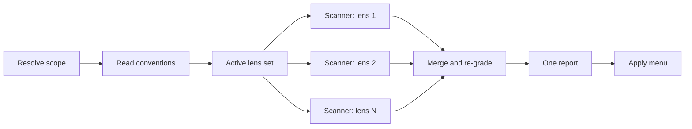

This page follows one review from the changed files to the apply menu.
It's for readers who want to know why a lens ran or didn't, why a finding got its severity, or why a fix landed in one menu option and not another.
For running a review, see the [start-cr guide](/plugins/code-review/start-cr/).

## The flow

The review settles everything that is the same for every lens once, then fans out, then brings the results back to one place:

Figure 1. One review, from the changed files to the apply menu

1. **Resolve scope.** The file list is computed once, and every scanner gets a slice of that same list.
2. **Read conventions.** Your project's rules are read once into one note that every scanner receives.
3. **Active lens set.** The input decides which lenses run. You never pick them.
4. **Scan.** One scanner agent per active lens judges the change in parallel and writes its findings to a file.
5. **Merge and re-grade.** The orchestrator collects every lens file, dedups, re-grades severity against one table and renders one report.
6. **Apply menu.** One question offers the fixes cut by risk, and asks how to commit them.

## The lenses

A lens is one cluster of written rules.
There are eleven: nine run on any change of code, and two depend on the input.

| Lens | Runs | Looks for |
|---|---|---|
| comments | always | Comments that narrate the code, cite tickets or other files, contradict the code, or are missing where a decision needs explaining. |
| readability & tests | always | Nesting a guard clause would flatten, unnamed magic values, functions doing several jobs, tests that don't check what their name claims. |
| naming & module | always | Names that hide intent, queries that change state, imports pointing the wrong way, helpers that duplicate one the repository already has. |
| objects & patterns | always, except on infrastructure code alone | Half-built objects, exposed internal collections, methods on the wrong object, repeated type switches. |
| simplicity & types | always | Duplication that collapses into one shape, code longer than its idea, needless casts, dead code. |
| correctness | always | Conditions that pick the wrong branch, unhandled cases, off-by-one bounds, swallowed errors, races, broken call contracts. |
| security | always | Secrets in source, injection, missing access checks, unvalidated input, insecure settings, widened access, in code, policies and CI workflows. |
| coherence | always | Two artifacts that describe the same thing differently: docs, contracts, migrations or config that disagree with the code, or code that breaks a rule an accepted ADR or `CONTEXT.md` states. |
| assumptions | always | Code relying on library, runtime, CI or platform behavior that the installed source or the locked version contradicts, and test doubles the real dependency wouldn't match. |
| performance | executable source in the change | N+1 calls, unbounded fetches, blocking calls on async paths, wasted React renders, queries on unindexed columns. |
| spec | a spec is named | Spec lines nothing implements, implemented wrongly or only partly, and behavior the spec never asked for. |

Table 1. The eleven lenses and when each runs

### How the input gates them

- **performance** runs when the change has executable source. Tests, test helpers, infrastructure code, `.sh` files and `*.config.*` modules don't count.
- **spec** runs when `--spec` names a readable local file, or when you accept the spec the review found in the change.
- **objects & patterns** is off when every file it would read is infrastructure code, because its rules have no counterpart there.
- **A lens with no files of its own is off.** A change of access policies only runs security, assumptions and coherence. A change of documents, changesets or config data only runs coherence, which reads the code each claim describes from the repository.

Each of these lenses still runs alongside spec when a spec is active.
The report's tally counts the lenses that ran (`Lenses: L of 11`) and names every lens that didn't, with its reason.

### What each lens reads

Every judged file gets a kind: `source`, `test`, `iac` or `policy`.
Tests get every lens except performance.
Access policies (`*.rego`, `*.cedar`, Cerbos and Kubernetes RBAC manifests, IAM policy files), `CODEOWNERS` and CI workflow files go to security, assumptions, coherence and spec only.

JSON, lockfiles, generated or minified files, Markdown, `.txt` and static config such as `.yaml`, `.toml`, `.ini` and `.env` are skipped and listed on the report's `Skipped` line.
Two lenses read them anyway:

- **coherence** reads every skipped file except lockfiles, generated output and real `.env` files, because a README, a migration or a compose file is one side of the disagreements it looks for.
- **spec** maps the spec against every changed file, skipped ones included, because a workflow or a manifest is often what a spec line describes.

A real `.env` file is never read.
Both lenses only search it for key names, never values.

## One scanner per lens

Each active lens runs as its own `code-review:scanner` agent.
The scanner invokes the `cr-scan` skill, reads its lens's rules file, judges the change, and writes its output to `<lens>.md` in the review's context directory.

- **It sees only what the review set up.** The scanner loads no `CLAUDE.md`. Your project's conventions reach it as `conventions.md`, the same note for every lens.
- **It has only the tools a lens needs:** Skill, Read, Grep, Glob, Bash and Write. It edits nothing in the checkout and starts no agents.
- **It runs on your session's model.** `start-cr` passes no model to its scanners.
- **It passes doubt on instead of dropping it.** Three side channels carry what a scanner can't settle alone: a `HANDOFF` for a problem another lens owns, a `CANDIDATES` entry when the rule fit is unsure, and a `(verify)` mark when the fact itself needs checking.

Separate scanners are the point.
Each reads the change on its own, so when several land on the same code, that agreement means something.

## Conventions suppress, standards generate

Before any lens runs, the review reads your project's own rules.
They come in two kinds:

- **Files that only remove findings:** `CLAUDE.md` and `AGENTS.md` (at the root and in every directory down to the reviewed file), `CONTRIBUTING.md`, `.cursor/rules` and `.claude/rules/*.md`. When one documents a style, the review stops flagging it.
- **Files that create findings:** `CODING_STANDARDS.md` at the repository root, and a gitignored `CODING_STANDARDS.local.md` beside it. An explicit rule in them becomes a `standards` finding that quotes it.

Decision records create findings too.
The coherence lens flags code that breaks a rule an accepted ADR, `CONTEXT.md` or a decision document in the change states.
The [reference](/plugins/code-review/reference/#project-files-the-review-reads) has the full rules.

## Central re-grading

The scanners judge the code; the orchestrator decides what survives.
It merges the lens files through these checks:

1. **Check that every lens delivered.** A missing lens file, a file with no `Lens:` header, or one that presents itself as a partial list counts as a lens that didn't report. The review runs that lens again, and never merges around the gap.
2. **Dedup.** When two findings point at the same code, from any lenses, each is re-graded first, then the one whose rule grades highest survives.
3. **Count convergence.** A finding several lenses reached on their own leads its file. Convergence raises confidence and order, never severity.
4. **Route every handoff and candidate.** Each one becomes a graded finding, merges into one, or is cleared in `Not flagged` with a reason.
5. **Resolve every `(verify)` mark** by reading the code. A refuted finding is dropped and noted.
6. **Re-grade every severity** against one master table of 68 rules. A scanner's grade is a first pass; the table's row is the one that ships.
7. **Judge the fix, not only the finding.** A fix that would change what callers observe, contradict another fix, or create the next finding is moved to the structural walk or to report only.

Step 4 is published as one counted line above the report, for example `Reconciliation: 3 handoffs + 2 candidates → 2 merged · 1 own bullet · 0 boy-scout · 2 Not flagged; 0 primary dropped · 1 passed on`.
The numbers must add up, so an entry that went missing shows.

## One apply menu

Every kept finding gets one risk class for its fix: `safe`, `structural` or `report-only`.
The apply menu offers those classes as its options, at most four, and only those that have findings:

- **Safe fixes** are mechanical and easy to check by eye. A fix that changes a signature, edits a second file, creates a module or adds an import is never safe.
- **Structural fixes** move or remove code. You walk them one at a time, and each needs its own yes.
- **Security fixes are never safe.** However small, they change behavior at a boundary.
- **Spec findings are report only.** A missing requirement is work to do, not an edit. The exception is a verified wrong implementation that one edit fixes.
- **Some coherence and assumptions fixes are report only**, wherever the side the fix would rewrite may be the right one, or the fix lives outside the repository, such as a dependency bump.

Before the first edit, the report and your selection go to a file in the session's scratch directory, so a long walk survives a context compaction.

## What stays on disk

| Path | What it holds |
|---|---|
| context directory, in the session's scratch directory | `scope.json` (files, kinds, base, lens set), `conventions.md`, `standards.md`, and one `<lens>.md` per scanner. |
| report file, in the session's scratch directory | The rendered report, your selection and a mark on each fix as it lands. |
| `<repo>.worktrees/cr-pr-<number>` | With `--pr`, when your checkout isn't at the pull request's head. Remove it with `git worktree remove`. |
| draft review file | In reviewer mode, the request body for the GitHub review, kept when you choose not to post it. |

Table 2. What a review leaves behind

Nothing else is written, and nothing is committed unless you chose a commit mode.

## Next steps

- [Run a review with `/code-review:start-cr`](/plugins/code-review/start-cr/).
- Look up arguments and the headless steps in the [reference](/plugins/code-review/reference/).
