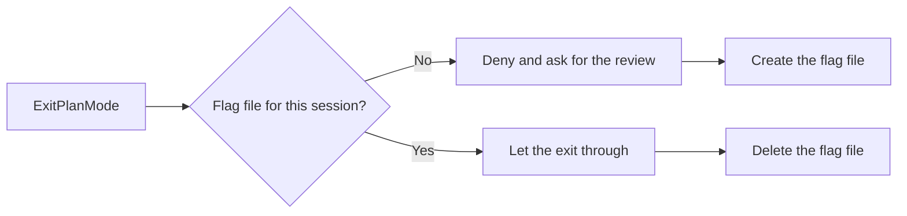

import LifeMap from '~/components/LifeMap.astro'
import SkillFlow from '~/components/SkillFlow.astro'
import Strip from '~/components/Strip.astro'

A plan written by one model has that model's blind spots.
codex-plan-improver gets a second opinion from OpenAI Codex before any code is written.
Claude sends the plan to Codex, revises it from the feedback, and repeats until Codex approves or five rounds pass.

The plugin has two parts:

- **A hook** that asks Claude for the review each time it leaves plan mode.
- **The command** `/codex-plan-improver:codex-review`, which runs the review. The hook asks Claude to run it, and you can run it by hand.

## Where it works

<LifeMap focus="codex-plan-improver" animate={false} />

The review runs in [Plan](/lifecycle/plan/), on a plan Claude wrote in plan mode or in chat.

## Before you start

You need the [OpenAI Codex CLI](https://github.com/openai/codex), installed and signed in:

```bash
npm install -g @openai/codex
codex login
```

Instead of `codex login`, you can put an API key in the environment.
The plugin also needs `jq` and `uuidgen` on your `PATH`, and a writable `/tmp`.
macOS ships `uuidgen`; install `jq` with `brew install jq`.

If the install summary says a reload is needed, run `/reload-plugins` so the hook takes effect.

## Review when you leave plan mode

Work in plan mode as usual. You don't run anything:

1. Claude calls `ExitPlanMode` to show you the plan.
2. The hook denies that call and tells Claude to run `/codex-plan-improver:codex-review`.
3. Claude runs the review and revises the plan.
4. Claude calls `ExitPlanMode` again. The hook lets it through, and you see the revised plan.

The following diagram shows how the hook decides, per session, whether an exit goes through:



Figure 2. The plan-exit hook alternates: it denies one exit, lets the next through, then denies the one after that.

Because the hook alternates, a plan you reject and Claude revises is reviewed again on its next exit.

:::caution
The hook asks for the review but can't force it. If Claude skips the review and calls `ExitPlanMode` a second time, that exit goes through unreviewed.
:::

## Review a plan by hand

Run the command at any point when a plan exists in the conversation:

<Strip cmd="/codex-plan-improver:codex-review" />

If there is no plan in the conversation, Claude asks what you want reviewed.

The default model is `gpt-6.1-sol`.
To use a different one, pass its name as the argument, for example `/codex-plan-improver:codex-review gpt-6-astra`.
Any model name your Codex CLI accepts for `codex exec -m` works.
The `model` setting in `~/.codex/config.toml` doesn't apply, because the command always passes `-m`.

## How it runs

<SkillFlow
  n={3}
  skill="codex-review"
  input="A plan in the conversation"
  steps={[
    { name: 'Capture', does: 'Claude writes the plan to a temporary file.', leaves: '/tmp/claude-plan-<id>.md' },
    { name: 'Review', does: 'Codex reviews the plan in a read-only sandbox and ends with a verdict.', leaves: '/tmp/codex-review-<id>.md' },
    { name: 'Revise', does: 'On REVISE, Claude changes the plan and lists each change.', loop: 'back to the same Codex session, up to five rounds' },
    { name: 'Finish', does: 'Claude shows the final status and deletes both temporary files.' },
  ]}
/>

Codex reviews the plan for correctness, risks, missing steps, simpler alternatives, and security.
It can read your repository for context but can't change files.
Later rounds resume the same Codex session, so Codex keeps the context of earlier rounds.

## What you see

For each round, Claude shows two blocks:

- **Codex Review — Round N:** Codex's feedback, ending in `VERDICT: APPROVED` or `VERDICT: REVISE`.
- **Revisions (Round N):** what Claude changed in the plan, one bullet per issue.

The review ends with a final status: approved after N rounds, or "Max rounds (5) reached" with the remaining concerns listed.
If Codex gives no clear verdict but raises nothing to act on, Claude treats the plan as approved.
Claude skips any Codex suggestion that contradicts a requirement you stated, and tells you it did so.

## Turn the automatic review off

Set `CC_TOOLKIT_CODEX_PLAN_REVIEW` to any value other than `1` or `true`:

```bash
export CC_TOOLKIT_CODEX_PLAN_REVIEW=0
```

The hook then lets every `ExitPlanMode` through. The manual command still works.
The [reference](/plugins/codex-plan-improver/reference/) lists every setting and the files the plugin writes.

## What can go wrong

- **The hook never asks for a review.** Check that `jq` is on your `PATH`. Without it the hook can't answer, and every exit goes through unreviewed.
- **Codex CLI is missing or fails.** Claude tells you and suggests installing it with `npm install -g @openai/codex`.
- **The Codex session can't be resumed**, for example because it expired. Claude falls back to a fresh Codex call and includes the earlier rounds in the prompt.
- **Five rounds pass without approval.** Claude lists the remaining concerns, and you decide whether to go ahead or keep refining.

## Next steps

- Build the approved plan: see [Build](/lifecycle/build/).
- For a change that needs every decision settled and checked against the code, write a spec with [`/fd3:build-spec`](/plugins/fd3/build-spec/).
