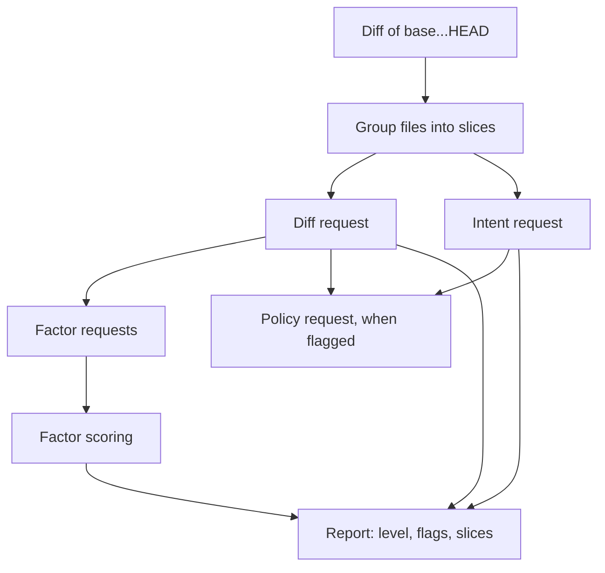

This page follows one assessment from the diff to the level on the label. It's for readers who want to know why a pull request got its level, or who want to change how the assessment works. For what the result looks like on a pull request, see [The risk label](/plugins/dev-kit/risk-assessment/).

In short, the change is split into slices, TypeSafe's Jev model answers fixed questions about each slice, and code turns the answers into a level. Jev never picks the level itself. Every rule that turns answers into a level is in code and is reported in the result.

## The pipeline

The following diagram shows the steps of one assessment and the requests sent for each slice:

Figure 1. The requests of one assessment, from the diff to the report

1. The tool reads the diff of the branch against its base.
2. It groups the changed files into slices.
3. For each slice, it sends a diff request and an intent request side by side, then the factor requests.
4. When the repository's testing rules were passed, a slice flagged as logic without tests gets one more request, the policy request.
5. Code scores the factor answers into a level and builds the report.

At most four Jev requests run at the same time. A request that fails with a rate limit or a server error is tried up to three times in all.

## Step 1: Read the diff

The tool diffs `<base>...HEAD`, preferring `origin/<base>` over a local branch. It leaves out lockfiles, binaries, minified files, source maps, snapshots and anything under `dist/`, `build/`, `vendor/` or `node_modules/`. It cuts context lines to one around each change, which keeps more of the change inside one request.

A change made only of left-out files isn't rated low. The tool reports it as unavailable.

## Step 2: Group the files into slices

A slice is one purpose of the change, such as a feature, a fix or a refactor, with every file that serves it: code, tests, configuration and docs. Slices let a pull request with a risky fix and a harmless docs update show both, instead of one blended level.

The slices come from the first source that works:

1. **The caller.** `pr-open` passes the slices it sees in the diff.
2. **Claude Haiku.** Without slices from the caller, Haiku groups the files from their paths, line counts, hunk headers and the commit messages.
3. **Size.** When Haiku fails, the diff is packed by size and assessed as one unsliced change.

Every file ends up in exactly one slice. There are at most eight slices, and files that a grouping leaves out go to an **Other changes** slice.

## Step 3: Ask Jev about each slice

Jev answers questions in two forms. A yes/no question returns the probability of yes. A scale question returns a probability for each level of the scale. The tool reads a yes when its probability is at least 0.7. A few change types that Jev over- or under-reports use 0.8 or 0.6 instead. The level of a scale question is the median of its probabilities.

### The diff request

The diff request holds the slice's file list and its diff. Docs, diagram sources and changesets go in a separate field, so Jev doesn't mistake a description of a change for the code that makes it. Agent instruction files, such as `CLAUDE.md`, stay with the code, because they direct an agent.

It asks:

- **Change types:** yes/no questions on what the slice touches, such as a schema migration, authorization, an API contract, CI, cloud infrastructure, UI components or a dependency update. The [reference](/plugins/dev-kit/risk-assessment/reference/#change-types-and-flags) lists the ones that raise flags.
- **Impact and likelihood:** two scale questions that set the slice's level only when the factor requests fail. See [Confidence, partial results and failures](/plugins/dev-kit/risk-assessment/reliability/#when-jev-doesnt-answer).

### The intent request

The intent request holds no file content. It holds the `context` passed in, the commit messages, and each file's git status and line counts. It asks what the slice does: adds new functionality, changes existing behavior, changes when an existing behavior applies, fixes a bug, refactors, renames or moves, or removes code. A rename or a deletion that git reports counts without asking.

### The factor requests

The factor requests decide the level. They hold the slice's code diff without its docs, and without its tests when the slice has other code. A slice of docs alone gets no factor requests and adds no risk.

The factor request asks:

| Question | Scale |
|---|---|
| **Impact of a mistake** | none, minor, feature, core, severe |
| **Complexity** | edits, simple logic, interacting logic, outside dependency, ordering or shared state |
| **Behavior change** | from "users get exactly what they got before" to "something users relied on is replaced or taken away" |
| **Reach, reversibility, failure breadth and failure handling** | give the impact and complexity answers their context |
| **Manual evidence** | would a video, screenshots or an API request and response show that the slice works? |

Table 1. The factor questions

The testability request is sent beside it, with the test files anywhere in the change. It asks whether an automated test could reasonably check the slice. A slice of tests alone isn't asked about manual evidence or testability.

Jev's answers vary between two identical requests. So every factor and testability request is sent twice, and the two answers' probabilities are averaged before the median is read.

### The policy request

When `pr-open` found the repository's testing rules, a slice flagged as logic without tests gets one more request. It holds the rules, the slice's file statistics and change types, and the test files in the change. It asks whether the rules expect tests that the change lacks. When Jev says no, the flag is dropped, and the slice doesn't count as a test gap. A failed policy request keeps the flag.

## Step 4: Score the answers

The level comes from two numbers per slice: the impact of a mistake, and the likelihood of one.

### Impact and likelihood

Impact is the factor request's impact answer:

| Impact | A mistake would… |
|---|---|
| none | not affect users, stored data or running systems |
| minor | cause a glitch people notice quickly, such as wrong text or layout, and lose nothing |
| feature | break one feature for some users until a fix ships; a revert restores everything |
| core | break a core flow for most users, take a service down, or block other teams' builds or deployments |
| severe | expose data or access, lose or corrupt stored data, or cause effects a revert can't undo, such as sent messages or payments |

Table 2. The impact levels

Likelihood comes from complexity. Logic that depends on something outside the diff is as hard to get right as several interacting paths inside it, so both count as non-trivial:

| Complexity | Likelihood |
|---|---|
| edits | mechanical |
| simple logic | simple |
| interacting logic | non-trivial |
| outside dependency | non-trivial |
| ordering or shared state | intricate |

Table 3. From complexity to likelihood

### The risk matrix

Impact and likelihood meet in this matrix:

| Impact \ Likelihood | mechanical | simple | non-trivial | intricate |
|---|---|---|---|---|
| none | low | low | low | low |
| minor | low | low | low | medium |
| feature | low | medium | medium | high |
| core | medium | medium | high | high |
| severe | medium | high | critical | critical |

Table 4. The risk matrix

A mechanical edit to something severe, such as a rename across access policies, is medium. Only a likely mistake with a severe outcome is critical.

Each slice gets its own level from its own impact and likelihood. The level of the whole change takes the worst impact of any slice and the worst likelihood of any slice. Two slices can therefore combine: a severe-impact config edit and an intricate refactor elsewhere in the same pull request rate critical together.

### Rules that move the level

Four rules change the result of the matrix. Each one that applies is listed in the result's `adjustments`.

- **Critical guard.** A severe impact anywhere, together with non-trivial or intricate complexity anywhere, makes the change critical. Manual evidence doesn't lower it.
- **Major-version floor.** When a slice's dependency manifest moves a runtime dependency to a new major version, its likelihood is at least non-trivial. The breaking changes are in the dependency, not in the diff that Jev reads.
- **Evidence credit.** A slice's likelihood drops one step when all of these hold:
  - its impact is feature or lower;
  - Jev is confident (0.7 or more) that at least one kind of manual evidence would show the slice works;
  - the description carries every kind of evidence that Jev finds plausible (above 0.3);
  - the slice has no test gap.

  The credit never lowers a slice below the major-version floor.
- **Test gap.** A slice that changes behavior and has no test has a test gap. It doesn't when no automated test could check it, or the testing rules clear it. A test gap blocks the evidence credit: a screenshot doesn't replace a missing test.

For example, a slice that changes a settings form has feature impact and simple logic, so it's medium. With a screenshot in the description and a test beside the form, it drops to mechanical likelihood and rates low. Without the test, it stays medium.

### What counts as a test and as evidence

A slice counts as tested when it holds a test file, or when one of its files shares a name with a test file anywhere in the change. `export.ts` matches `export.test.ts`, `export.spec.ts` or `export.stories.tsx`. Test files include stories, fixtures, mocks, and Cypress and Playwright files.

The description counts as carrying evidence when it holds:

- **Screenshots:** an image uploaded to GitHub.
- **Video:** a video uploaded to GitHub, a link to a `.mp4`, `.mov` or `.webm` file, or a Loom share link. A video also counts as screenshots.
- **API request and response:** a code block that starts with `curl` or an HTTP status line, or holds a JSON object or a `"status"` field.

## Flags, change types and intents

Flags, change types and intents describe the change for the reviewer. They come from the diff and intent requests, and they don't set the level.

- **Flags** are read from the change types. For example, the security flag comes from the authorization, authentication or secret-handling types.
- **Logic without tests** marks a slice with code that adds, changes or fixes behavior and has no test. The policy request can drop it.
- **Intents** fill the table's **What it does** column.

## Next steps

- [Confidence, partial results and failures](/plugins/dev-kit/risk-assessment/reliability/): what happens when part of the change can't be assessed or Jev doesn't answer.
- [Risk label reference](/plugins/dev-kit/risk-assessment/reference/): every option, input and output field.
