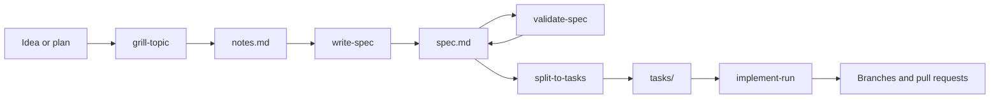

You type three commands, but each one starts several parts.
This page names them, so you recognize them in the `/` menu and in run output, and explains the two skills that run only inside `/fd3:build-spec`.

## The flow

Each command hands the next one a file, never the conversation:

Figure 1. The files that pass between the fd3 steps

`/fd3:build-spec` runs `grill-topic`, then `write-spec`, then `validate-spec`.
`/fd3:split-to-tasks` reads the spec and writes the tasks.
`/fd3:implement` runs `implement-tasks`, which launches the `implement-run` workflow over the tasks.
Because every step reads files, a run that stops halfway restarts from them.

## The parts

| Name | Kind | Started by | Role |
|---|---|---|---|
| `grill-topic` | skill | you, or `build-spec` | The interview. |
| `write-spec` | skill, hidden from the `/` menu | `build-spec` | Writes the spec from the confirmed notes. |
| `validate-spec` | skill, hidden from the `/` menu | `build-spec` | Checks the spec and appends the verdict. |
| `split-to-tasks` | skill | you | Cuts the spec into task files. |
| `implement-tasks` | skill | `/fd3:implement` | Asks the questions, launches the workflow, works its report, and proposes the push. |
| `implement-run` | workflow | `implement-tasks` | Waves, merges, checks and review. In repair mode, applies your decisions to existing branches. |
| `fd3:researcher` | sub-agent | the skills | Looks up documentation and other external facts through context7 and firecrawl. |
| `fd3:toolchain-scout` | sub-agent | `implement-run` | Finds a repository's build, typecheck, lint and test commands, starting from its CI configuration. |
| `fd3:ci-runner` | sub-agent | `implement-run` | Runs those commands on a branch, or on the clean base, and waits for each to finish. |

Table 1. The parts fd3 starts for you

`implement-run` shows up in the `/` menu as `/fd3:implement-run`.
Don't run it directly: it expects the parsed task graph that `implement-tasks` hands it.

## Inside build-spec

`write-spec` and `validate-spec` run in their own contexts, so their reading never fills your conversation.
You never run them by hand.
Their questions reach you through `build-spec`, as multiple-choice prompts.

### Writing the spec

`write-spec` reads two things: the closing notes from the interview and the research directory.
A fact in neither is declared as a gap or looked up, never recalled.
It writes the spec against a twelve-section template: header and precedence, problem and goal, design decisions, target architecture, ownership, the change per repository, rollout, verification, cleanup, out of scope, tickets, and the evidence record.

Every piece the spec says will be built gets a permanent element code, such as `DB-1` or `API-2`.
Tasks, verification rows and evidence refer to elements by code.
It also moves the session's working files from the scratch directory into a git-ignored `<spec>.session/` folder beside the spec.

### Validating the spec

`validate-spec` decides whether the spec can be implemented, or split into tasks, as written.
It runs twelve checks over the whole document, for example:

- the decisions don't contradict each other, and nothing silently reverses an earlier document,
- every element has a description, a contract and a way to check the delivered result,
- every external API is confirmed against its documentation,
- the build order holds, and the work can actually land in each repository the way the spec says,
- no claim rests on a vague verb or an undecided either/or.

Each claim then gets a status:

| Status | Meaning |
|---|---|
| `verified` | The evidence holds. |
| `deferred` | The spec declares the gap and names an owner and a placement. This passes. |
| `blocked` | Nothing settles it, and the spec names no owner. |
| `open` | Not settled yet during this pass. |

Table 2. Claim statuses in a verdict

The verdict is `ready` when every claim is verified or deferred and no check is left open.
`validate-spec` edits the spec only to repair one of its own findings.
It runs any command that settles a claim in a detached worktree under the scratch directory, never in your checkout, and it never installs dependencies.

`build-spec` runs another pass while the verdict is `not ready` and a pass could still close what remains, or while the last pass edited the spec, up to three passes.
When the spec changes after the final verdict, it runs one more pass on exactly those edits.

## Inside implement

`implement-tasks` parses the task files with a script, `scripts/task-graph.mjs`, that checks for dependency cycles, unknown statuses and broken branch bases.
A broken graph stops the run, with a recommendation to split again.

Validation runs one branch at a time, so only one build, lint and test pipeline runs on your machine.
For the same reason only one `implement-run` runs at a time, in either mode: repairs go first, then the relaunch.
While a workflow runs, its worktrees and branches belong to it.

A relaunch passes the previous report's path, so the workflow reuses what it already learned about each repository's checks instead of scouting and measuring them again.

## Task statuses

Each task file's `status` field is the run's state store:

| Status | Meaning |
|---|---|
| `todo` | Not started. |
| `in-progress` | An agent is working on it. Left behind by an interrupted run, it is a question on the next launch. |
| `implemented` | The code is on the task's own `task/<slug>` branch. |
| `merged` | The code is on the target branch, waiting for checks and review. |
| `blocked` | Only a person can move it. |
| `done` | The branch passed its final checks, and its review when review is on. Nothing holds it for you. |

Table 3. Task statuses

A branch stays `merged`, not `done`, when its review didn't run, or when a `gated` review left findings for you.

## Glossary

- **Spec**: the design document fd3 writes and checks. Every later step reads the spec, not the conversation.
- **Element code**: a permanent code for one thing the spec says will be built, such as `DB-1`.
- **Declared gap**: something the spec couldn't settle, written down with who resolves it and where it blocks. The split turns it into a task for that owner.
- **Verdict**: the line validation appends to the spec.
- **Rollout phase, gate**: the spec orders the work into phases. A gate is a point where something outside the code has to happen first, such as a deploy, a waiting period or an approval.
- **Landing unit**: the consecutive phases up to and including a gate. Its tasks in one repository share a branch.
- **Stacked branches**: a later branch that starts from an earlier one, so its pull request targets that branch until the earlier one merges.
- **Wave**: one round of parallel implementation, covering every task whose dependencies are finished.
- **HIL item** (human in the loop): anything the run stopped on because only a person can decide it or do it.
- **Lens**: one focus of the code review, such as security or performance. Each active lens is one review agent.

## Next steps

- [Reference](/plugins/fd3/reference/) lists the requirements, arguments, files and task fields.
- [Write your first spec](/plugins/fd3/#write-your-first-spec) if you haven't yet.
