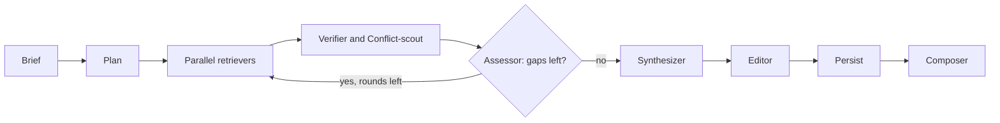

researcher has two parts.
The `research` skill runs in your session: it settles the brief, picks the report folder, launches the workflow, and handles follow-ups.
The bundled workflow, `workflows/research.js`, runs in the background and does the research, the writing, and the rendering.
Only the report path and a short manifest come back to your session, so the HTML never enters your context.

## The research loop

The workflow plans search angles, then runs research rounds until an assessor says coverage is sufficient or the round cap is reached.
The following diagram shows one run, from the brief to the rendered report:

Figure 1. One run of the research workflow. The Verifier runs only at Deep depth.

The run goes through these stages in order:

1. **Setup** creates the report folder. When it extends a report, it loads that report's `state.json` and checks its schema version.
2. **Plan** splits the question into distinct angles, so parallel searches don't all land on the same popular page. When the question asks what a named product or standard supports, at least one angle goes to that vendor's own documentation.
3. **Research rounds** run retrievers in parallel, one per angle: 3 at Quick depth, 5 at Standard, and 6 at Deep. Each retriever searches with firecrawl, reads the best pages, and extracts findings. When firecrawl fails or a site blocks it, the retriever falls back to WebSearch and records that in its notes.
4. **Synthesizer** runs once, after the loop. It reconciles the findings into one cited answer and keeps any contradiction it can't resolve, with attribution.
5. **Editor** cuts the answer for the audience you chose and marks where a chart, diagram, table, or source image helps.
6. **Persist** saves the findings and the state before anything is rendered.
7. **Composer** renders `output.html` and copies the stylesheet. It copies Chart.js only when the report has a chart, and compiles diagrams with `mmdc` only when `mmdc` is installed.

## How a round decides to continue

After the retrievers return, the workflow merges their sources by URL and gives each new source the next free number.
Then up to three checks run over the gathered findings, in this order:

- **Verifier** runs only at Deep depth. It tries to refute the findings from the gathered material. A refuted finding is dropped; one that needs more evidence becomes a gap.
- **Conflict-scout** runs every round. It finds claims that contradict each other, without fetching anything new.
- **Assessor** is the only gate. It ends the loop when coverage is sufficient and no material, resolvable conflict remains. Otherwise it lists specific gaps, and each gap becomes a retriever in the next round, up to the same per-depth limit.

A claim that a product supports something, backed only by blogs or forum threads, counts as a gap.
The next round goes to that vendor's own documentation instead of guessing.

The loop is bounded by rounds, not by tokens: 1 round at Quick, 2 at Standard, and 3 at Deep.
It also stops when a round after the first adds no new findings.
The Assessor proposes two to four follow-up questions on every run, and the skill offers them to you at the end.

## What makes a citation

Each source gets a trust tier when it's fetched:

| Tier | Means |
|---|---|
| primary | Official documentation, specifications, standards, or the actor's own statement |
| reputable secondary | Established press and well-known organizations |
| community | Forums, personal blogs, and unverified posts |

Table 1. Trust tiers a retriever assigns to each source.

Each finding carries evidence from its source.
Retrievers prefer a verbatim quote.
For a chart or figure they record the image and its caption.
For paywalled or non-text material they record a locator with a paraphrase, which is marked as non-verbatim.
The Synthesizer may cite only source numbers, so every `[n]` in the report points at a real entry in the source list.

## How a report evolves

A follow-up doesn't append a section.
The Synthesizer reads every earlier finding from disk and rewrites the whole answer from old and new findings together.

Earlier work is never overwritten:

- Before the new render, the previous `output.html` is copied to `snapshots/output.<UTC timestamp>.html`.
- New findings go into new files in `findings/`. Earlier files stay as they were.
- Source numbers continue from the highest existing one, so old citations still point at the same source.
- Diagrams and images get names with the round number, so older snapshots still show theirs.

A fresh report in the same folder clears `findings/` first.

## Why it saves before it renders

Persist writes `findings/`, `answer.md`, and finally `state.json` before the Composer starts.
It writes `state.json` last, so it never points at a findings file that wasn't written.
If saving fails, the run stops with `persist-failed` and leaves the previous report as it was.
If only the rendering fails, the data is already saved and a new run renders it again.
[Error codes](/plugins/researcher/reference/#error-codes) lists what each failure means.

## Next steps

- [Reference](/plugins/researcher/reference/): the settings, the files in the report folder, and the error codes.
- [researcher overview](/plugins/researcher/): run your first report.
- [`/fd3:build-spec`](/plugins/fd3/build-spec/): turn the findings into a spec.
