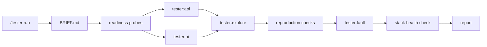

This page explains what happens inside a run.
You don't need it to use tester; read it when a verdict surprises you or before you allow real changes.

## The parts

`/tester:run` is the only part you start.
It discovers the stack, derives the suites, asks the questions and writes the report.
It hands each suite to one of four agents:

| Agent | Runs | With | Model |
|---|---|---|---|
| `tester:api` | API checks, plus read-only database queries where a check needs them | `curl` | `sonnet` |
| `tester:ui` | browser checks, with a screenshot of every failing check | agent-browser | `sonnet` |
| `tester:explore` | exploratory charters, returning leads rather than verdicts | `curl`, agent-browser | your session model |
| `tester:fault` | error-handling checks, by making a dependency fail | Docker, WireMock | your session model |

Table 1. The agents `/tester:run` dispatches, one per suite.

`tester:api` and `tester:ui` run on `sonnet` to save cost, because the brief has already settled every open question for them.
`tester:explore` uses your session model, because its charters ask for judgment rather than a fixed list of checks.
`tester:fault` uses your session model, because it is the one agent that disrupts the shared stack.

A plugin mod provides one tool, `runs`, that opens the run's directory, prunes old runs and finds the run a `--rerun` repeats.

## The flow

The following diagram shows the order in which the suites run:

Figure 1. API and UI suites run in parallel; exploration and its reproduction follow; the fault suite runs alone and last.

Before any suite starts, the main thread runs a few read-only readiness probes: one API call outside the scope under test, each test user's session, the start page of each UI suite, and each dependency the fault suite will disrupt.
A failed probe becomes a question, or `BLOCKED "doctor: <probe>"` on the suites that rest on it, never a `FAIL`.
The probes stay outside the scope so that a real defect in the feature isn't mistaken for a broken environment, and they run again after every restart.

The API and UI suites run in parallel, one agent per suite.
The exploratory suite runs after them, on the scope's surface, so its attempts don't disturb checks still running.
Its leads go back to `tester:api` or `tester:ui` as ordinary checks with a command and an expected result; only a lead that check reproduces becomes a `FAIL`.
The fault suite waits until they finish, because pausing a dependency or putting a proxy in front of it would corrupt checks still running.
After the fault suite, `/tester:run` checks that the stack is healthy itself rather than trusting the agent.

A suite that triggers something and waits minutes for its effect, such as an export or a queue consumer, runs in one agent that owns the whole chain.

## The brief

Discovery writes everything the suites need into one file, `BRIEF.md`, and every agent reads it.
The brief holds the base URLs and their quirks, the test users and their session files, the snapshot of the starting state, the curl, browser and database patterns, the dependencies that can be made to fail, the expected behavior each check asserts against, and the safety rules.

Each agent returns only its result table and a few notes, not request bodies or logs.
A suite's verdict is that table: the main thread classifies failures but doesn't re-run checks blindly.

## Evidence behind every verdict

A check passes only when a recorded command shows it.
A few rules keep that evidence honest:

- **No verdict on an action that never fired.** To report that something is missing, such as a row, a log line or a field, tester first proves that the action producing it ran. Without that proof, the check is `ERROR "stimulus not fired"`, not `FAIL`, because caches and async layers can swallow a trigger silently.
- **Evidence must come from the suite's own run.** An id or a timestamp from before the suite started invalidates the row, and tester re-checks it.
- **A restart starts a new generation.** Each restart of the app opens a numbered environment generation with its own log file. Baselines, sessions and counts from an earlier generation don't count as evidence.

## Making a dependency fail

The fault suite makes a dependency fail in one of three ways, in this order of preference:

1. **Pause or stop the dependency's container**, to test "the dependency is down".
2. **Point the app's base-URL setting for the dependency at a temporary WireMock proxy** that returns a chosen 5xx, a timeout or a malformed response.
3. **Add a small, reversible injection point in the source**, with your approval, when the app has no base-URL setting for that dependency.

Each fault check first proves that the fault is active, then asserts the app's behavior.
The dependency is always restored and the proxy removed, even when a check errors.
tester skips a fault check only after it has ruled out all three ways, and the report names what it checked.

## What stays on disk

Each run gets a directory in `~/.cache/tester/<repository>/`, outside your repository and shared by all its worktrees; the report gives its path.
It keeps the brief, the checks as derived in `SUITES.md`, the command and output behind every row in `evidence/`, the teardown ledger `TEARDOWN.md` and screenshots.
Session cookies and generated passwords sit in `secrets/`, which is deleted when the run ends; the next run also deletes any a crashed run left behind.
The oldest runs beyond the `run_retention` setting are deleted when a run starts.

Your repository changes only when you approve an injection point or keep a change in place on purpose.
The ledger lists either.

## Repeating failed checks

An LLM derives slightly different checks each time, so a fresh run after a fix doesn't compare like with like.
`--rerun` repeats the `FAIL`, `BLOCKED` and `ERROR` rows of a kept run with the exact commands recorded in its `evidence/`, instead of deriving them again.
Discovery, the readiness probes, sessions, the starting snapshot and the questions are all redone, because none of them carry over between runs.
The report groups the repeated rows as fixed, still failing and changed.

## Safety rules

- It refuses production-looking base URLs.
- It makes real changes through the app only on the surface you allowed.
- It records every change to your environment in the ledger when it makes it, reverts it, and checks the result against the starting snapshot.
- It deletes data it created in your stores, such as a bucket or a mailbox, by the exact name the app recorded, never by pattern. A delete count that doesn't match stops the cleanup.
- It keeps cookies, tokens and passwords out of the conversation.

:::note
tester keeps no test suite to maintain.
A fresh run derives its checks again from the spec or the diff, so there is nothing to update when the code changes; kept runs exist only for `--rerun` and are pruned by count.
:::

## Next steps

- [Run a check](/plugins/tester/run/) with `/tester:run`.
- Look up verdicts, defect classes and requirements in the [reference](/plugins/tester/reference/).
