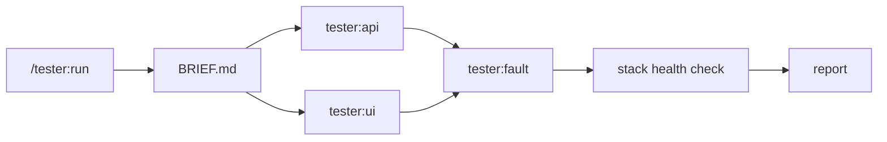

This page explains what happens inside a run.
You don't need it to use tester; read it when a verdict surprises you or before you allow real changes.

## The parts

`/tester:run` is the only part you start.
It discovers the stack, derives the suites, asks the questions and writes the report.
It hands each suite to one of three agents:

| Agent | Runs | With | Model |
|---|---|---|---|
| `tester:api` | API checks, plus read-only database queries where a check needs them | `curl` | `sonnet` |
| `tester:ui` | browser checks, with a screenshot of every failing check | agent-browser | `sonnet` |
| `tester:fault` | error-handling checks, by making a dependency fail | Docker, WireMock | your session model |

Table 1. The agents `/tester:run` dispatches, one per suite.

`tester:api` and `tester:ui` run on `sonnet` to save cost, because the brief has already settled every open question for them.
`tester:fault` uses your session model, because it is the one agent that disrupts the shared stack.

## The flow

The following diagram shows the order in which the suites run:

Figure 1. API and UI suites run in parallel; the fault suite runs alone and last.

The API and UI suites run in parallel, one agent per suite.
The fault suite waits until they finish, because pausing a dependency or putting a proxy in front of it would corrupt checks still running.
After the fault suite, `/tester:run` checks that the stack is healthy itself rather than trusting the agent.

A suite that triggers something and waits minutes for its effect, such as an export or a queue consumer, runs in one agent that owns the whole chain.

## The brief

Discovery writes everything the suites need into one file, `BRIEF.md`, and every agent reads it.
The brief holds the base URLs and their quirks, the test users and their session files, the snapshot of the starting state, the curl, browser and database patterns, the dependencies that can be made to fail, the expected behavior each check asserts against, and the safety rules.

Each agent returns only its result table and a few notes, not request bodies or logs.
A suite's verdict is that table: the main thread classifies failures but doesn't re-run checks blindly.

## Evidence behind every verdict

A check passes only when a recorded command shows it.
A few rules keep that evidence honest:

- **No verdict on an action that never fired.** To report that something is missing, such as a row, a log line or a field, tester first proves that the action producing it ran. Without that proof, the check is `ERROR "stimulus not fired"`, not `FAIL`, because caches and async layers can swallow a trigger silently.
- **Evidence must come from the suite's own run.** An id or a timestamp from before the suite started invalidates the row, and tester re-checks it.
- **A restart starts a new generation.** Each restart of the app opens a numbered environment generation with its own log file. Baselines, sessions and counts from an earlier generation don't count as evidence.

## Making a dependency fail

The fault suite makes a dependency fail in one of three ways, in this order of preference:

1. **Pause or stop the dependency's container**, to test "the dependency is down".
2. **Point the app's base-URL setting for the dependency at a temporary WireMock proxy** that returns a chosen 5xx, a timeout or a malformed response.
3. **Add a small, reversible injection point in the source**, with your approval, when the app has no base-URL setting for that dependency.

Each fault check first proves that the fault is active, then asserts the app's behavior.
The dependency is always restored and the proxy removed, even when a check errors.
tester skips a fault check only after it has ruled out all three ways, and the report names what it checked.

## What stays on disk

The brief, session cookies, the teardown ledger `TEARDOWN.md` and screenshots live in a temporary directory, `$TMPDIR/tester.XXXXXX`, whose path the report gives.
Nothing in it is committed, and it holds secrets, so tester never writes it into your repository.

Your repository changes only when you approve an injection point or keep a change in place on purpose.
The ledger lists either.

## Safety rules

- It refuses production-looking base URLs.
- It makes real changes through the app only on the surface you allowed.
- It records every change to your environment in the ledger when it makes it, reverts it, and checks the result against the starting snapshot.
- It deletes data it created in your stores, such as a bucket or a mailbox, by the exact name the app recorded, never by pattern. A delete count that doesn't match stops the cleanup.
- It keeps cookies, tokens and passwords out of the conversation.

:::note
tester keeps no test suite between runs.
Every run derives its checks again from the spec or the diff, so there is nothing to update when the code changes.
:::

## Next steps

- [Run a check](/plugins/tester/run/) with `/tester:run`.
- Look up verdicts, defect classes and requirements in the [reference](/plugins/tester/reference/).
